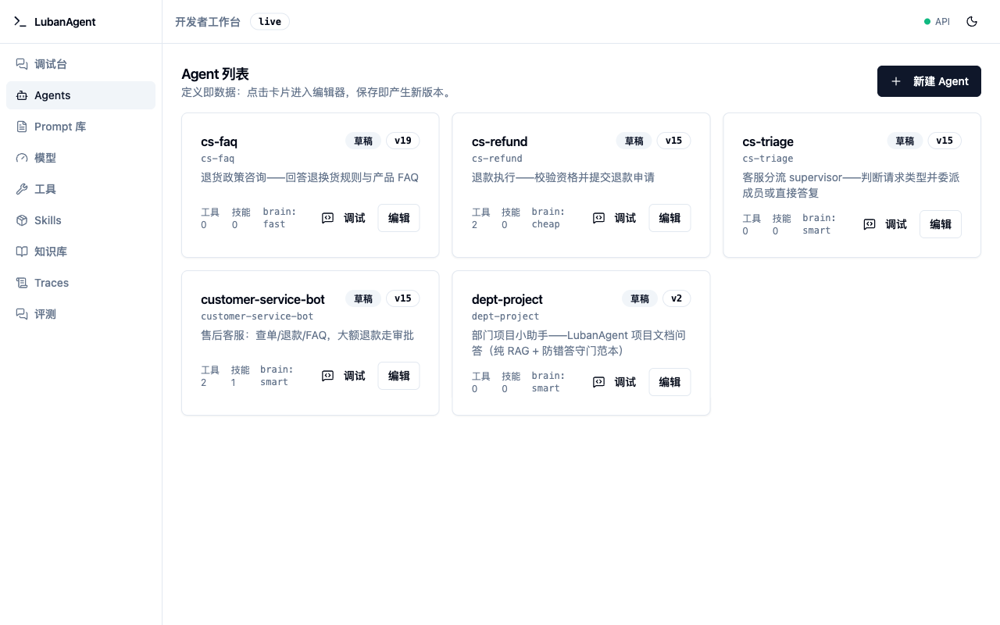
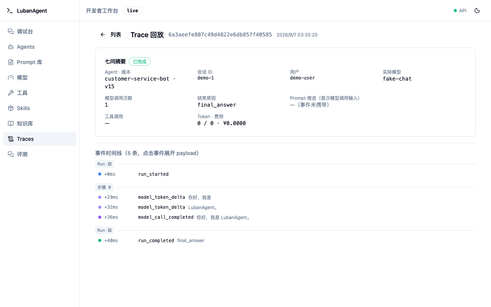

# LubanAgent


**Agent 开发，缺的从来不是编排框架，是工程基座。**

用 LangChain 写个 Agent demo，一个下午就够。难的是往后那一步：预算失控没人拦，费用算不清归谁，高风险操作靠 Prompt 自觉，换个模型要改代码发版，Run 崩了连现场都查不到。很多团队在这个坎上把原型扔掉，从头再造一遍治理。

Java 圈二十年前就用 Spring Boot 脚手架回答过这个问题：别让每个团队重复拼工程。LubanAgent 想给 Python Agent 圈当这个脚手架。它是开源（Apache-2.0）的 Agent 工程基座，克隆仓库、配一个模型，第一天就能写自己的业务 Agent；确定性规则由代码执行，预算、审批、崩溃恢复内建，改了源码也能长期跟上游升级。

> **English**: Agent demos are easy in Python; production is not — budget overruns, unclear cost attribution, prompts acting as governance, models hardcoded. LubanAgent is the missing engineering base (Apache-2.0) on Python ≥3.11 + LangChain + LangGraph: clone the repo, plug in a model, and ship your own agents on day one. It layers what teams otherwise rebuild themselves on top of LangGraph: versioned agent definitions in DB, a model factory with fast/smart/cheap/vision slots, governance with trace/budget/timeout, and a deployable workbench. See [README.en.md](docs/README.en.md).

Python ≥3.11 + LangChain + LangGraph，MySQL（开发期 SQLite 免安装）。内置的智能客服是首个完整验证场景：退货 Agent、FAQ、会话分诊、退款审批流，带 mock-biz 业务服务全链路跑通，不是玩具 demo。

> **第一次来？** 先判断是否适合你的业务 → [项目介绍与选型](website/manual/introduction.md) ｜ 准备试用 → [快速开始](website/manual/getting-started.md) ｜ 开发自己的业务 → [开发指南](website/tutorial/index.md) ｜ [在线文档](https://lozsh.github.io/LuBan/)

## 为什么是 LubanAgent

几个常被拿来比较的项目，差别在这里：

- **Dify / Coze Studio** 是低代码平台，给不写代码的人用。可视化编排降低了门槛，但业务规则埋在节点配置里，难以像代码一样测试和审查。LubanAgent 面向开发者，业务 Tool 就是 Python 代码，可以单测、可以 review。
- **Agno** 同样代码优先，但没有"克隆住进去"这一层：框架升级靠换依赖，你的定制跟着它的版本走。LubanAgent 的仓库就是你的项目，`app/` 领地放业务代码，上游不碰，`git merge` 跟版；预算熔断与费用归因、LangGraph 确定性图编排也都是一等能力。
- **OpenClaw** 是个人 AI 助手网关：把模型挂进几十个 IM 渠道，让个人在聊天软件里随时使唤 Agent。LubanAgent 面向企业生产系统：定义版本化、确定性规则代码强制、预算熔断与费用归因。渠道触达属本仓库商用扩展层的经营范围，开源核心只留 `ChannelConnector` 扩展点。
- 直接用 **LangChain / LangGraph / CrewAI**，拿到的是编排原语。LubanAgent 把编排引擎当依赖，补上编排之外的工程活：定义版本化、模型工厂、治理、评测、成本、部署。这些每个团队都要自己拼一遍。

| 维度 | LubanAgent | Dify / Coze Studio | Agno |
| --- | --- | --- | --- |
| 给谁用 | 长期住进源码的工程团队 | 不写代码的业务 / 运营人员 | 代码优先的 Agent 开发者 |
| 形态 | 全源码仓库，克隆即改，仓库即项目 | 可视化平台，在平台里配置（可自部署） | pip 框架 + AgentOS 运行时 + 托管控制面 |
| Agent 定义 | 存数据库、版本化、运行期可改不发版 | 平台内可视化配置 | 代码定义；API / Studio 创建的组件支持版本发布与回滚 |
| 确定性规则 | 代码执行：权限 / 金额 / 审批走 LangGraph 流水线，不靠 Prompt 赌 | 节点 / 插件配置 | 代码实现 |
| 治理成色 | 预算三道闸（token / 费用 / 时长）、费用归因、高风险 Tool 人工审批（持久化、并发安全、可恢复）、Run 全程留痕可回放 | 平台内置基础观测 | Tracing、HITL 审批、Evals |
| 改源码 + 跟上游 | 一等能力：领地隔离 + upstream 守卫 + 领地标签 CHANGELOG | 平台形态不适用 | 框架形态不适用（跟版 = 升级依赖） |
| 数据边界 | 无强制 SaaS：观测默认 Langfuse 自部署，内部 DB 唯一可信源 | 自部署版数据本地，云版数据在平台 | SDK 开源，Control Plane 为托管服务 |

在这个定位之上，基座自带：

| 能力 | 一句话 |
| --- | --- |
| **Agent 定义入库版本化** | Agent 的人设/工具/规矩是一份存库、版本化的定义，改配置不发版，运行期生效 |
| **模型工厂** | fast / smart / cheap / vision 四个逻辑槽位解耦 Agent 与具体模型，换模型 = 改库映射 |
| **治理层** | 步数 / 预算 / 超时 / 取消四道闸，Token 估算与费用归因，Run / Trace 全程留痕可回放 |
| **工程基座** | API Key 鉴权、CLI、迁移、CI、Docker 交付，以及"跟上游升级不丢你的改动"的领地契约 |
| **一个引擎两种用法** | 日常 Agent = prebuilt + 治理包装（不写图）；确定性流程 = 手写 LangGraph 图；多 Agent supervisor 委派——三者同库同治理 |
| **开发者工作台** | Agents / Prompt 库 / 模型 / 工具 / Skills / 知识库 / 流程图 / Traces / 评测 9 个管理页面 + 用户端聊天入口（/chat），开箱即用 |

工作台 Agents 页，定义、版本、状态、调试台入口在一屏：



Trace 详情，一次 Run 的完整现场（模型、工具调用、Token/费用），随时回放：



全源码没有黑盒，权限、金额、审批这类确定性规则由代码执行，不靠 Prompt 声明。观测默认 Langfuse 自部署，数据在自己手里，也可切 LangSmith 或完全关闭；内部 DB 始终是 source of truth，没有强制 SaaS。

## 先跑起来看看

不想配 Python 环境的话，Docker 一条命令起全栈：

```bash
docker compose up -d --build   # 首次约 3-5 分钟，之后秒起
```

然后看三样东西：

1. 打开 <http://localhost:8000/chat>，对内置客服说一句"我买的鞋子想退货"，看它走完分诊和退款流程；
2. 打开 <http://localhost:8000> 进工作台，Traces 里点开刚才那次 Run：哪个 Agent 版本、哪个模型、调了哪些工具、多少 Token、多少钱，全程留痕可回放；
3. 回到工作台 Agents 页，改一句人设保存，再到 `/chat` 说句话。新定义已经生效，没发版、没重启。

> 零密钥口径：不配模型 Key 时由 FakeLLM 兜底（固定台词），验证的是链路不是智力；想看真智力，按下一步「快速开始」接一个真模型。

<!-- 演示 GIF 占位：人工录制 30s 后替换（录制指引见 docs/demo-recording.md） -->
<!--  -->

## 快速开始

前置：Python ≥3.11、[uv](https://docs.astral.sh/uv/)；跑全栈（含工作台前端）另需 Node.js ≥20。

```bash
uv venv --python 3.12 .venv
uv pip install --python .venv/bin/python -e ".[dev]"
cp app/config/.env.example .env   # 零配置也能起：SQLite + FakeLLM 兜底
.venv/bin/luban migrate           # 建表
.venv/bin/luban init              # 导入种子 Agent/Tool/知识源
.venv/bin/python -m pytest        # 全量测试（零外部密钥）
```

验证 Agent 真的能说话（无需模型 Key，FakeLLM 兜底，回复为固定台词，验证的是链路；想看真智力，见下一步接真模型）：

```bash
.venv/bin/uvicorn app.main:create_app --factory --port 8000 &
curl -N -X POST http://localhost:8000/v1/agents/customer-service-bot/runs \
  -H "Content-Type: application/json" \
  -d '{"input": "你好"}'
# SSE 事件流：run.started → token.delta… → run.completed
```

接真实模型两步：`.env` 填厂商 API Key，再通过工作台"模型"页或 API 把模型写入库、绑到逻辑槽位（连接信息存数据库，换模型不改代码不发版）：

```bash
DEEPSEEK_API_KEY=sk-xxx        # 或 DASHSCOPE_API_KEY / ZHIPUAI_API_KEY / OPENAI_API_KEY
```

```bash
# 1. 注册模型（连接信息入库；单价字段用于费用归因，可不填）
curl -X PUT http://localhost:8000/v1/models -H "Content-Type: application/json" -d '{
  "key": "deepseek-chat", "provider": "deepseek", "model_name": "deepseek-chat",
  "factory": "openai_compat", "api_key_env": "DEEPSEEK_API_KEY",
  "base_url": "https://api.deepseek.com/v1",
  "capability": {"tool_calling": true},
  "params": {"input_price_per_1k": 0.002, "output_price_per_1k": 0.008}
}'
# 2. 绑到逻辑槽位（Agent 定义不动，新 Run 立即走新模型）
curl -X PUT http://localhost:8000/v1/brain-mappings -H "Content-Type: application/json" \
  -d '{"profile": "smart", "model_key": "deepseek-chat"}'
```

> 也支持任意 OpenAI 兼容服务（vLLM / Ollama 自建端点）：在 ModelDefinition 里显式指定 base_url 与 `api_key_env` 即可。

起本地全栈（后端 API + 工作台前端）：

```bash
scripts/dev.sh start    # 工作台 http://localhost:5173 ，API http://localhost:8000
                        # 首次运行自动 npm install 拉前端依赖（约 1 分钟），之后秒起
```

## 一键全栈（Docker）

零配置起完整演示栈：app（含工作台 UI）+ MySQL 8 + Langfuse（观测）+ mock-biz（客服示例业务服务）。镜像内三阶段构建：node 打工作台前端 → venv → 运行时，UI 与 API 同端口。

```bash
docker compose up -d --build       # 首次约 3-5 分钟（含前端构建）
# 容器内 app 启动时自动 luban migrate && luban init（幂等，重起安全）
#   工作台+API http://localhost:8000               （UI 由 FastAPI 同端口托管）
#   用户端聊天 http://localhost:8000/chat          （直接跟内置客服对话）
#   Langfuse http://localhost:3000               （Trace 观测 UI）
#   mock-biz http://localhost:9100               （客服示例业务服务）
```

生产部署须知：设 `AUTH_ENABLED=true` 并配 `API_KEY`、改 Langfuse 密码、用真实 MySQL 凭证、挂载持久卷。详见 [UPGRADE.md](docs/UPGRADE.md)。

## 部署指引：后端 / 前端 / 文档站怎么起、怎么发布

| 部分 | 本地开发 | 发布 / 部署 |
| --- | --- | --- |
| **后端 API** | `scripts/dev.sh start`（或手动 `.venv/bin/uvicorn app.main:create_app --factory --port 8000`） | 随 Docker 镜像交付（`docker compose up -d --build`）；生产清单见 [UPGRADE.md](docs/UPGRADE.md) 与 [手册·部署](website/manual/deploy.md) |
| **前端工作台** | `scripts/dev.sh start` 一并拉起（http://localhost:5173）；也可单独跑：`cd lubanagent/ui && npm install && npm run dev` | 不单独部署——镜像内三阶段构建（`npm run build`），产物由 FastAPI 同端口托管（http://localhost:8000 即含 UI） |
| **文档站**（教程 + 使用手册） | `cd website && npm ci && npm run dev`（VitePress，默认 5173 端口，与工作台冲突时用 `npx vitepress dev --port 5180` 换端口） | GitHub Pages 自动发布（见下） |

### 文档站发布（GitHub Pages）

流水线已内置：[.github/workflows/docs.yml](.github/workflows/docs.yml) 在 push 到 `master` 且改动涉及 `website/**` 时自动构建部署，也可在仓库 **Actions → docs → Run workflow** 手动触发。

首次启用只需一步：仓库 **Settings → Pages → Source 选 GitHub Actions**（不要选 "Deploy from a branch"）。

之后每次合并到 `master`，站点自动发布到 `https://<用户名>.github.io/<仓库名>/`（workflow 构建时通过 `DOCS_BASE=/<仓库名>/` 自动设置子路径 base，无需手工配置）。

本地验证生产产物（带仓库名 base）：

```bash
cd website && DOCS_BASE=/<仓库名>/ npm run build && npm run preview
```

## 仓库布局：你住哪里，框架住哪里

LubanAgent 是一个生产级起步基座，定位类似 Java 圈的若依 / Spring Boot 脚手架：你克隆仓库后长期住进去迭代、上生产，不是搭完就扔的原型。为此仓库划分了三块领地：

```text
lubanagent/   框架领地 —— 上游追踪，你原则上不动
app/          你的领地 —— 你的 Agent / Tool / 流程 / 扩展都放这里，上游永不主动触碰
demos/ tests/ docs/ migrations/   共享领地
```

依赖方向单向（`app → lubanagent` 允许、反向禁止），由 import-linter 在 CI 强制；`.lubanagent-upstream` 守卫在 CI 拦截上游对用户领地（user-owned 路径）的改动，显著降低合并冲突——但不承诺任意 git merge 零冲突。跟上游升级走 `git merge`，按 CHANGELOG 领地标签（`[framework]` / `[scaffold-seed]` / `[shared]` / `[migration]` / `[breaking]`）对号入座——完整升级指南见 [UPGRADE.md](docs/UPGRADE.md)。

## 内置示例：智能客服

系统自带一个完整的客服场景（退货流程 Agent、FAQ、会话分诊、退款审批流），当作活文档读：怎么定义 Agent、怎么写确定性退款流程的 LangGraph 图、怎么接业务系统。示例带 mock-biz 业务服务，`docker compose up` 即可全链路体验。

## 还内置了一套方法论

仓库自带 [spec-coding](.claude/skills/spec-coding/) skill（规格驱动开发闭环：意图 → 契约 → 编码 → 独立严审）：正向把开发意图落成可验证契约再编码；逆向把代码演进同步回资产文档。开发本仓库用它，你开发自己的 Agent 也可以用，克隆即用，语言无关。

## 我该看哪份文档（按人群）

| 你是谁 | 从这里进 |
| --- | --- |
| **第一次接触，想搞懂这是什么** | [项目介绍与选型](website/manual/introduction.md) + 本 README |
| **想本地跑起来体验** | 本 README「快速开始」；工作台页面怎么用看[手册·开发者工作台](website/manual/features/workbench.md) |
| **要开发自己的业务 Agent（长期住进仓库）** | [使用手册](website/manual/index.md)：功能手册（[定义](website/manual/features/agent-definition.md) / [模型](website/manual/features/models.md) / [Tool](website/manual/features/tools-mcp.md) / [Skill](website/manual/features/skills.md)）→ [图编排](website/manual/features/graphs.md) → [多 Agent](website/manual/features/multiagent.md)；改造场景看[改造指南](website/manual/customization/overview.md)，跟上游升级走 [UPGRADE.md](docs/UPGRADE.md) |
| **负责部署 / 运维 / 上线** | 本 README「部署指引」（后端 / 前端 / 文档站怎么起、怎么发布）+ [UPGRADE.md](docs/UPGRADE.md)（生产部署清单）+ [手册·部署与生产清单](website/manual/deploy.md) |
| **想读懂框架源码 / 深入设计决策** | [架构设计](docs/design-docs/LubanAgent-architecture-design.md)（目录/领地/模块关系）→ [模块规格](docs/specs/index.md)（13 个模块逐个的接口/数据/行为/边界） |

## 文档

| 文档 | 内容 |
| --- | --- |
| [使用手册](website/manual/index.md) | 每个功能的"是什么 / 为什么 / 怎么用 / 边界" + API 参考 + 改造指南 |
| [开发指南](website/tutorial/index.md) | 创建 Agent、接模型、写工具、配置知识、评测、流程与部署，按开发任务查阅 |
| [架构设计](docs/design-docs/LubanAgent-architecture-design.md) | 目录结构、领地隔离、模块关系、关键技术决策 |
| [模块规格](docs/specs/index.md) | 13 个模块的接口 / 数据 / 行为 / 边界规格，按模块导航 |
| [CHANGELOG](CHANGELOG.md) / [UPGRADE](docs/UPGRADE.md) | 变更记录与升级指南 |
| [技术方案 / 开发计划 / PRD](docs/design-docs/) | 设计过程文档，供深入参考 |

## 技术栈

- **语言/框架**：Python ≥3.11 + LangChain（core 1.6）+ LangGraph 1.2（硬约束的地基；后端 FastAPI 0.143 / SQLAlchemy 2.1 / Pydantic 2.14，精确版本由 `uv.lock` 冻结）
- **模型接入**：OpenAI 兼容协议优先（DeepSeek / Qwen / GLM / vLLM / Ollama 一个客户端全覆盖）
- **数据库**：MySQL 8.0+（生产）/ SQLite（开发期免安装）；ORM + Alembic 迁移
- **观测**：可插拔 `ObservabilityBackend`，默认 Langfuse 自部署，可选 LangSmith / none
- **工作台**：React 18 + TypeScript + Vite，API 类型由 OpenAPI 快照自动生成，前后端契约同源、漂移在 CI 拦截

> 范围边界：LubanAgent 不做在线托管 SaaS、低代码设计器、模型/Prompt 商城、通用后台管理、自建观测平台。客服是示例场景，不是产品本身。IM/电商等渠道接入属商用扩展层，不在本仓库。

## License

Apache-2.0
