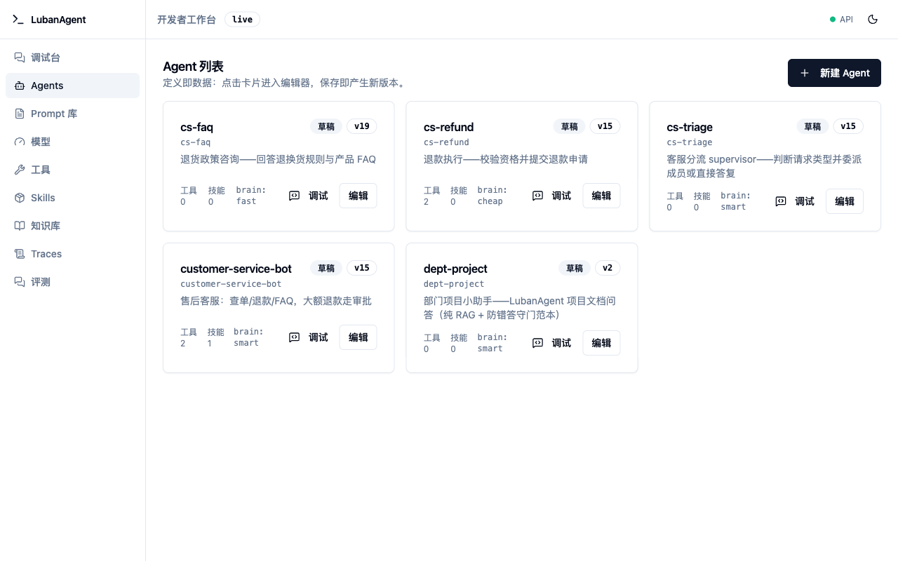
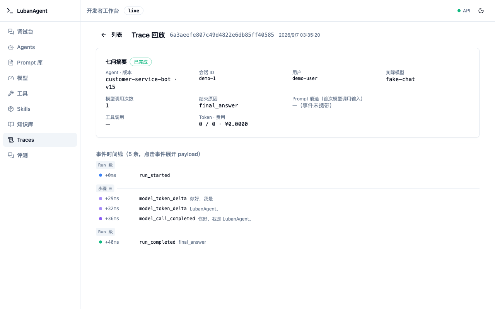

# LubanAgent


**An open-source (Apache-2.0) agent engineering base: clone the repo, plug in a model, and ship your own agents on day one.**

Python ≥3.11 + LangChain + LangGraph, MySQL in production (SQLite for zero-setup development), with a built-in customer-service example as the first end-to-end scenario. **中文文档见 [README.md](../README.md)。**

## Why LubanAgent

LangGraph / CrewAI / AutoGen / Dify solve *orchestration* — but turning an agent into a product takes a large chunk of platform engineering that every team rebuilds from scratch:

- Agent definitions scattered across code — changing a persona requires a release
- Switching models means changing code; no graceful degradation when a model is down
- No incident forensics, no cost attribution, no upgrade discipline

LubanAgent doesn't reinvent orchestration — it treats LangGraph as a dependency and layers the missing engineering base on top:

| Capability | In one sentence |
| --- | --- |
| **Versioned agent definitions** | Persona / tools / rules live as versioned records in the database — change config without a release, effective at runtime |
| **Model factory** | Four logical slots (fast / smart / cheap / vision) decouple agents from concrete models — switching a model is a DB mapping change |
| **Governance** | Step / budget / timeout / cancellation circuit breakers, token estimation with cost attribution, fully recorded & replayable Runs and Traces |
| **Engineering base** | API-key auth, CLI, migrations, CI, Docker delivery, plus a territory contract that keeps your changes mergeable with upstream |
| **One engine, two usage modes** | Everyday agents = prebuilt + governance wrapping (no graphs to write); deterministic flows = hand-written LangGraph graphs; multi-agent = supervisor delegation — all share one DB, one governance, one deployment |
| **Developer workbench** | 9 management pages (Agents / Prompts / Models / Tools / Skills / Knowledge / Flow graphs / Traces / Evals) + a user-facing chat entry (/chat), out of the box |

**Workbench Agents page**:



**Trace detail** (full record of a run: model, tool calls, tokens/cost, replayable):



**No black boxes**: full source code; deterministic rules (permissions / amounts / approvals) are enforced by code, not by prompt declarations. **No forced SaaS**: observability defaults to self-hosted Langfuse (data sovereignty), can switch to LangSmith or be disabled entirely; the internal DB is always the source of truth.

> **First time here?** In a hurry → [30-minute tour of the built-in customer service demo](../demos/customer_service/README.md) (Chinese) ｜ Want to learn it properly — concepts, exercises, 8 lessons from zero to deployment → **[Tutorial](../website/tutorial/index.md)** (Chinese, also published as a standalone docs site under [website/](../website/))

## Quick Start

Prerequisites: Python ≥3.11 and [uv](https://docs.astral.sh/uv/); Node.js ≥20 additionally for the full stack with the workbench UI.

```bash
uv venv --python 3.12 .venv
uv pip install --python .venv/bin/python -e ".[dev]"
cp app/config/.env.example .env   # works with zero config: SQLite + FakeLLM fallback
.venv/bin/luban migrate           # create tables
.venv/bin/luban init              # import seed agents/tools/knowledge sources
.venv/bin/python -m pytest        # full test suite (no external API keys)
```

Verify an agent actually talks (FakeLLM fallback — no model key needed; replies are a fixed canned line, this verifies the pipeline; real intelligence needs a model key, see the next step):

```bash
.venv/bin/uvicorn app.main:create_app --factory --port 8000 &
curl -N -X POST http://localhost:8000/v1/agents/customer-service-bot/runs \
  -H "Content-Type: application/json" \
  -d '{"input": "Hello"}'
# SSE event stream: run.started → token.delta… → run.completed
```

Connecting a real model takes two steps: put a provider API key in `.env`, then register the model via the workbench "Models" page or `PUT /v1/models` and bind it to a logical slot (connection details live in the DB — switch models without code changes or releases):

```bash
DEEPSEEK_API_KEY=sk-xxx        # or DASHSCOPE_API_KEY / ZHIPUAI_API_KEY / OPENAI_API_KEY
```

> Any OpenAI-compatible service works too (vLLM / Ollama self-hosted endpoints): set `base_url` and `api_key_env` explicitly in the ModelDefinition.

Start the local full stack (backend API + workbench frontend):

```bash
scripts/dev.sh start    # workbench http://localhost:5173 , API http://localhost:8000
```

## One-command Full Stack (Docker)

Zero-config demo stack: app (with workbench UI) + MySQL 8 + Langfuse (observability) + mock-biz (customer-service example business service). The image is a three-stage build — node builds the workbench frontend, then venv, then the runtime — UI and API share one port.

```bash
docker compose up -d --build       # ~3-5 minutes on first run (includes frontend build)
# The app container runs luban migrate && luban init on startup (idempotent, restart-safe)
#   Workbench+API http://localhost:8000               (UI served by FastAPI on the same port)
#   Chat          http://localhost:8000/chat          (talk to the built-in customer-service agent)
#   Langfuse      http://localhost:3000               (trace observability UI)
#   mock-biz      http://localhost:9100               (example business service)
```

Production notes: set `AUTH_ENABLED=true` with an `API_KEY`, change default Langfuse credentials, use real MySQL credentials, mount persistent volumes. See [UPGRADE.md](UPGRADE.md) (Chinese).

## Repository Layout: Where You Live, Where the Framework Lives

LubanAgent is a **production-grade starter base** (think what RuoYi / Spring Boot scaffolds are to Java business systems) — you clone it, move in, iterate, and take it to production; it's not a throwaway prototype. The repo is divided into three territories:

```text
lubanagent/   framework territory — tracks upstream; you don't touch it in principle
app/          your territory      — your agents / tools / flows / extensions; upstream never touches it
demos/ tests/ docs/ migrations/   shared territory
```

The dependency direction is one-way (`app → lubanagent` allowed, the reverse forbidden), enforced by import-linter in CI; the `.lubanagent-upstream` guard blocks upstream commits touching user-owned paths in CI, which significantly reduces merge conflicts — but no guarantee of zero-conflict merges. To follow upstream upgrades, `git merge` and reconcile via CHANGELOG territory tags (`[framework]` / `[scaffold-seed]` / `[shared]` / `[migration]` / `[breaking]`) — full guide in [UPGRADE.md](UPGRADE.md) (Chinese).

## Built-in Example: Customer Service

The system ships with a complete customer-service scenario (refund-flow agent, FAQ, conversation triage, refund approval flow) — read it as living documentation: how to define agents, how to write a deterministic refund flow as a LangGraph graph, how to integrate a business system. The example includes a mock-biz service; `docker compose up` gives you the full chain.

## A Methodology Comes Bundled Too

The repo ships with the [spec-coding](../.claude/skills/spec-coding/) skill (a spec-driven development loop: intent → contract → code → independent strict validation): forward mode turns development intent into verifiable contracts before coding; reverse mode syncs code evolution back into the asset docs. We develop this repo with it — you can develop your own agents with it too. Works on clone, language-agnostic.

## Which Doc Should I Read (by audience)

Most docs are in Chinese; the code and workbench UI are the universal language.

| Who you are | Start here |
| --- | --- |
| **New here, want to understand what this is** | This README + [Tutorial lesson 0](../website/tutorial/00-primer.md) (Chinese) |
| **Want to run it locally** | "Quick Start" in this README; for the workbench pages, see [User manual · Workbench](../website/manual/features/workbench.md) (Chinese) |
| **Building your own business agents (living in this repo)** | [User manual](../website/manual/index.md) (Chinese): features (agent definitions / models / tools / skills) → graph orchestration → multi-agent; for customization see the [customization guide](../website/manual/customization/overview.md), and follow [UPGRADE.md](UPGRADE.md) to track upstream |
| **Deploying / operating it** | "One-command Full Stack" in this README + [UPGRADE.md](UPGRADE.md) (production checklist) + [User manual · Deploy](../website/manual/deploy.md) (Chinese) |
| **Reading framework source / design decisions** | [Architecture design](design-docs/LubanAgent-architecture-design.md) → [Module specs](specs/index.md) (interface / data / behavior / boundary per module) |

## Documentation

| Doc | Contents |
| --- | --- |
| [User manual](../website/manual/index.md) (Chinese) | Every feature in "what / why / how / boundaries" form + API reference + customization guide |
| [Tutorial](../website/tutorial/index.md) (Chinese) | 8+1 hands-on lessons from zero to deployment (docs site source in [website/](../website/)) |
| [Architecture design](design-docs/LubanAgent-architecture-design.md) (Chinese) | Directory layout, territory isolation, module relations, key decisions |
| [Module specs](specs/index.md) (Chinese) | Interface / data / behavior / boundary specs for 13 modules |
| [CHANGELOG](../CHANGELOG.md) / [UPGRADE](UPGRADE.md) | Changes and upgrade guide (territory-tagged) |
| [PRD](product-specs/LubanAgent-prd.md) (Chinese) | Product definition and framework comparison |

## Tech Stack

- **Language/framework**: Python ≥3.11 + LangChain + LangGraph (the hard-constraint foundation)
- **Model access**: OpenAI-compatible protocol first (DeepSeek / Qwen / GLM / vLLM / Ollama via one client)
- **Database**: MySQL 8.0+ (production) / SQLite (development, zero install); ORM + Alembic migrations
- **Observability**: pluggable `ObservabilityBackend` — default self-hosted Langfuse, optional LangSmith / none
- **Workbench**: React 18 + TypeScript + Vite, API types generated from the OpenAPI snapshot (zero frontend/backend contract drift)

> Scope: LubanAgent is not a hosted SaaS, a low-code designer, a model/prompt marketplace, a general-purpose admin panel, or a self-built observability platform. Customer service is an example scenario, not the product. IM/e-commerce channel integration belongs to a commercial extension layer, not this repo.

## License

Apache-2.0
