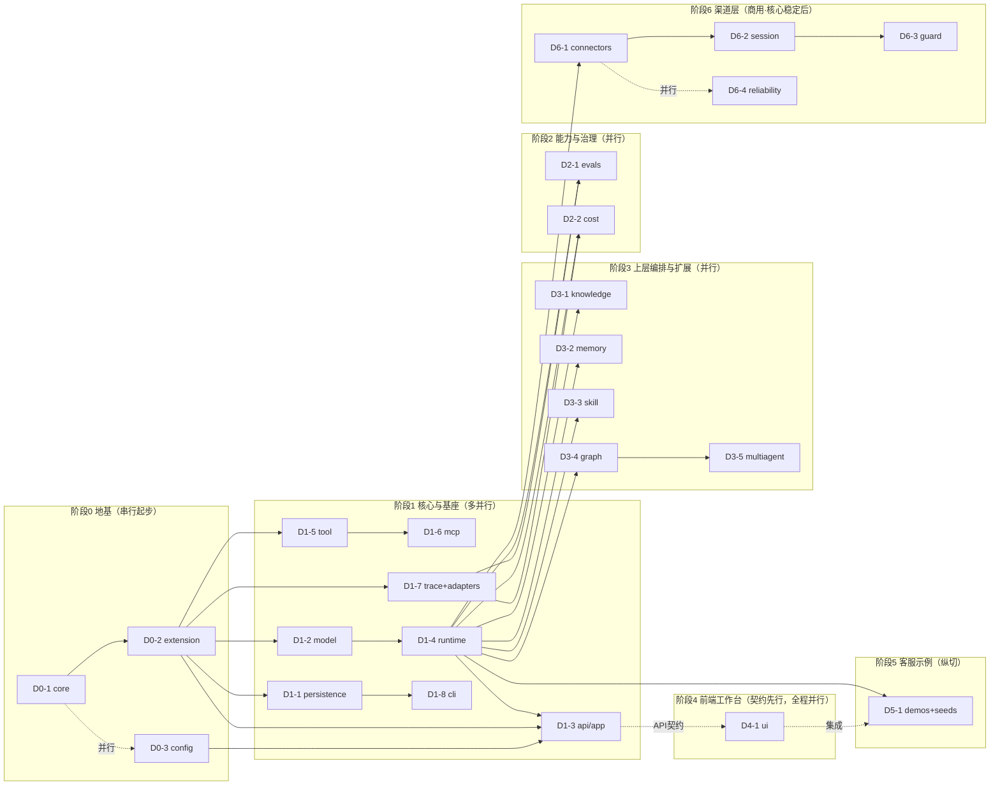

# LubanAgent 开发计划

> 文档状态：方案稿 v1.0 | 2026-07-21
> 上位文档：`../product-specs/LubanAgent-prd.md`、`LubanAgent-technical-proposal.md`、`LubanAgent-architecture-design.md`、`../../website/manual/`（使用手册）
> 本文回答：**AI 按什么顺序、拆成哪些单元、各自开发什么、怎么验收、哪些能并行、哪些必须人工介入**。读完即可被 AI 直接执行。

---

## 0. 总则

### 0.1 开发主体与口径

- **开发主体 = AI**。不考虑人工投入，功能不分期（F1-F16 一次性交付），仅按构建依赖排序实现。
- 本计划是"执行级"的：每个开发单元给出 **开发内容 / 关键架构 / 验收标准 / 依赖 / 可并行性**，AI 按单元实现，单元内自验通过即合并。
- "直接执行" = 每个单元交付即**可运行、可测**；全部单元组合后 `docker compose up` 起来即是一个可用的 LubanAgent。

### 0.2 四条贯穿全局的硬约束（改代码/写代码必须守住，见架构设计 §3、§4）

1. **领地隔离**：`lubanagent/`（框架）↔ `app/`（用户）↔ `demos/`（示例）物理分目录；依赖方向单向 `app/* → lubanagent/*` 允许，反向禁止；`demos/*` 不被框架/用户反向依赖。
2. **渠道层可拆卸**：`lubanagent-channels/* → lubanagent/*` 允许，反向禁止；核心只定义 `ChannelConnector`/`SessionStateStore`/`OutputGuard` 三个 Protocol，渠道层实现可整体卸载。不装渠道层时核心经 REST/SSE 独立运行。
3. **YAML 非运行期存储**：Agent 定义运行期主存储是 DB，YAML 仅 `luban init`/`luban export` 用。
4. **import-linter 守卫**：上述依赖方向写进 `importlinter.toml`，CI 强制，违反即构建失败。

### 0.3 契约先行（前后端并行的基础）

开发者工作台（前端）与后端**不串行**：先用 Pydantic 定义请求/响应模型与路由签名 stub（FastAPI 自动产出 OpenAPI），前端用该 OpenAPI codegen 出 TS 类型与 API client，双方对着同一份契约开发。后端路由实现可分批落地，前端先用 mock 跑通，后端就绪后切真。

本仓库内置 spec-coding skill（`.claude/skills/spec-coding/`）形式化这套契约驱动流程，是本仓库方法论卖点：**正向**从本计划提取每个开发单元的契约（接口/数据/行为/边界/验收标准）→ 按契约编码 → strict-validation subagent 校验「代码 vs 契约」直至 PASS；**逆向**在代码演进后扫描真实代码回写 `docs/`。AI 执行本计划时按 spec-coding 正向路径逐单元推进。

### 0.4 执行方式建议

可用多 Agent 编排执行：一个 Orchestrator 按本计划的阶段顺序调度，架构师先出 `coding_report.md`（API 契约 + 数据模型 + 模块划分），后端/前端/测试 Agent 在可并行单元上并发，安全审查与代码审查在每阶段收口。本计划已按可并行的粒度切分单元，直接对应多 Agent 任务。

---

## 1. 开发单元总览

| 单元 | 模块 | 领地 | 归属 | 依赖 | 可并行 |
| --- | --- | --- | --- | --- | --- |
| D0-1 | `lubanagent/core` 领域模型+错误体系 | 框架 | F1/F2/F3 契约 | 无（最底层） | 阶段0起步 |
| D0-2 | `lubanagent/extension` Protocol+Registry+装饰器 | 框架 | 扩展点 | D0-1 | 与 D0-3 并行 |
| D0-3 | `lubanagent/config` 环境化配置 | 框架 | F8 | 无 | 与 D0-2 并行 |
| D1-1 | `lubanagent/persistence` DB模型+仓储+Alembic | 框架 | F1/F5 存储 | D0-1 | 与 D1-2/5/7 并行 |
| D1-2 | `lubanagent/model` 模型工厂+大脑解析 | 框架 | F2 | D0-1 | 与 D1-1/5/7 并行 |
| D1-3 | `lubanagent/api`+`app` REST/SSE 接入+装配 | 框架 | F8 | D0-2、D0-3、D1-4 | API stub 早在 D1-4 前 |
| D1-4 | `lubanagent/runtime` Agent Runtime | 框架 | F3 | D1-2、D0-2 | 串行在 D1-2 后 |
| D1-5 | `lubanagent/tool` Tool 治理 | 框架 | F4 | D0-1 | 与 D1-1/2/7 并行 |
| D1-6 | `lubanagent/mcp` MCP Client/Server | 框架 | F4 | D1-5 | 串行在 D1-5 后 |
| D1-7 | `lubanagent/observability/trace`+adapters | 框架 | F5 | D0-1、D1-1 | 与 D1-1/2/5 并行 |
| D1-8 | `lubanagent/cli` luban 命令行 | 框架 | F1/F6 | D1-1（`luban eval` 额外依赖 D2-1） | 与 D1 阶段后期并行 |
| D1-9 | CI + 测试基建（import-linter/pytest/前端 build/FakeLLM） | 横切 | 全局守卫 | D0-2、D1-2 | import-linter 在 D0-2 后即起 |
| D1-10 | Prompt 库一等实体化（core/prompt + prompts 表 + /v1/prompts + 工作台 Prompt 库页） | 框架 | F1/F10 | D1-1、D1-3 | 与 D1-9 并行（已完成） |
| D2-1 | `lubanagent/observability/evals` 评测体系 | 框架 | F6 | D1-4、D1-7 | 与 D2-2 并行 |
| D2-2 | `lubanagent/observability/cost` 成本治理 | 框架 | F7 | D1-4、D1-7 | 与 D2-1 并行 |
| D3-1 | `lubanagent/knowledge` 最小 RAG | 框架 | F9 | D0-1、D1-4 | 与 D3-2/3/4 并行 |
| D3-2 | `lubanagent/memory` 记忆策略 | 框架 | F9 | D0-1、D1-4 | 与 D3-1/3/4 并行 |
| D3-3 | `lubanagent/skill` Skill 运行时 | 框架 | F12 | D0-1、D1-4 | 与 D3-1/2/4 并行 |
| D3-4 | `lubanagent/graph` 图编排 | 框架 | F11 | D1-4 | 与 D3-1/2/3 并行 |
| D3-5 | `lubanagent/multiagent` 多 Agent | 框架 | F13 | D3-4 | 串行在 D3-4 后 |
| D4-1 | `lubanagent/ui` 开发者工作台前端 | 前端 | F10 | API 契约(D1-3) | 与 D1/D2/D3 后端并行 |
| D5-1 | `demos/customer_service`+`app/` seeds | 示例 | 验证场景 | D1-4、D1-5、D3-1（基础幕）；D3-3（Skill）、D3-4（graph）、D3-5（multiagent）、D2-1（evals）补齐对应演示幕 | 纵切逐步落地 |
| D6-1 | `lubanagent-channels/connectors` | 商用渠道层 | F14 | D0-2、D1-4 | 与 D6-4 并行 |
| D6-2 | `lubanagent-channels/session` | 商用渠道层 | F15 | D6-1 | 串行在 D6-1 后 |
| D6-3 | `lubanagent-channels/guard` | 商用渠道层 | F16 | D6-2 | 串行在 D6-2 后 |
| D6-4 | `lubanagent-channels/reliability` | 商用渠道层 | F14 可靠性 | D6-1 | 与 D6-2/3 并行 |

> 渠道层（D6-*）属商用独立模块，不进开源仓库；核心稳定后开发，依赖核心但不被核心依赖。

---

## 2. 并行开发总图



**并行要点**：

- 阶段 0 的 `core` 是一切地基，必须最先；`extension` 与 `config` 可并行。
- 阶段 1 内四大独立支线并行：`persistence` ∥ `model→runtime` ∥ `tool→mcp` ∥ `trace`；`api/app` 在 `runtime` 后接，但其 **API stub 可在 runtime 前先出**以解锁前端。
- 阶段 2、3 内部高度并行：`evals`∥`cost`；`knowledge`∥`memory`∥`skill`∥`graph`，仅 `multiagent` 串在 `graph` 后。
- 前端 `ui` 一旦拿到 API 契约即可开工，与后端阶段 1-3 全程并行。
- 渠道层阶段 6 只依赖 `core`+`runtime`，可在核心稳定后与前端/示例并行启动。

---

## 3. 分阶段开发详案

> 每个单元统一给：**开发内容 / 关键架构 / 验收标准 / 依赖 / 可并行性**。验收标准以"可运行、可测"为底线。

### 阶段 0：地基与契约

#### D0-1 `lubanagent/core` 领域模型与错误体系

- **开发内容**：`core/definition.py`（AgentDefinition/AgentVersion/IOContract）、`run.py`（Run/RunStatus/RunContext[Deps]）、`trace.py`（Trace/TraceEvent/Step 及事件类型枚举）、`brain.py`（BrainProfile fast/smart/cheap/vision）、`model.py`（ModelDefinition/ModelCapability）、`tool.py`（ToolDescriptor/RiskLevel/ToolContract）、`budget.py`（Budget/TokenEstimate）、`errors.py`（LubanError 体系 + 公共错误码）。
- **关键架构**：dataclass/Pydantic + Protocol，最底层——不依赖 DB/HTTP/LangChain 等重依赖（Pydantic 属基础库，允许）。所有事件类型在此定义，供 trace 适配器翻译。
- **验收标准**：`pytest tests/lubanagent/core/` 全绿；`import lubanagent.core` 不触发 DB/HTTP/LangChain 等重依赖加载；模型能序列化为 JSON（DB 存储前置）。
- **依赖**：无。
- **可并行**：阶段 0 起步点，最先完成。

#### D0-2 `lubanagent/extension` 扩展点 Protocol + Registry + 装饰器

- **开发内容**：`extension/protocols.py`（ToolProvider/GraphProvider/AuthProvider/ObservabilityBackend/Hook/KnowledgeConnector 及渠道层 ChannelConnector/SessionStateStore/OutputGuard）、`registry.py`（运行期 Registry：tool/graph/skill/auth/observability/hook 注册与查找）、`decorators.py`（`@tool`/`@graph`/`@hook` 装饰器，约定优于配置地扫 `app/tools/`、`app/graphs/`）。
- **关键架构**：框架运行期只从 Registry 取实例，**绝不 import 用户模块名**——这是领地隔离的运行期兜底。Protocol 用 typing.Protocol，用户实现接口而非继承基类。
- **验收标准**：注册一个 mock ToolProvider，Runtime 能从 Registry 取到；`@tool` 装饰的函数能被自动发现并注册；import-linter 规则覆盖 `lubanagent → app` 禁止方向。
- **依赖**：D0-1。
- **可并行**：与 D0-3 并行。

#### D0-3 `lubanagent/config` 环境化配置

- **开发内容**：`config/settings.py`（pydantic-settings，env 分层覆盖 dev/staging/prod）、`config/defaults.py`。覆盖模型映射、DB 连接、观测后端选择、鉴权开关等。
- **关键架构**：所有运行期可变项走 env/DB，代码里不硬编码。`OBSERVABILITY_BACKEND`、`BIZ_BASE_URL`、`DATABASE_URL` 等在此统一入口。
- **验收标准**：`.env.example` 齐全；`Settings()` 从 env 正确加载；缺省值保证零配置也能起（SQLite + noop 观测兜底）。
- **依赖**：无。
- **可并行**：与 D0-2 并行。

### 阶段 1：核心领地与工程基座

#### D1-1 `lubanagent/persistence` DB 模型 + 仓储 + Alembic

- **开发内容**：`persistence/models/`（agents/agent_versions/runs/traces/trace_events/token_usages/cost_records/models/brain_mappings/skills/mcp_servers/eval_datasets/eval_results 等 SQLAlchemy 模型）、`persistence/repositories/`（仓储层，面向领域对象）、`persistence/migrations/`（Alembic 首版 schema）。
- **关键架构**：开发期 SQLite 免安装、生产 MySQL 8.0+，仓储层抹平方言差异。LangGraph checkpointer 表也在此落（落自有 DB，不引外部服务）。
- **验收标准**：`alembic upgrade head` 在 SQLite 与 MySQL 各跑通一次；仓储 CRUD 测试全绿；表结构含版本化字段（`version`、`agent_version_id`）。
- **依赖**：D0-1。
- **可并行**：与 D1-2 / D1-5 / D1-7 并行。

#### D1-2 `lubanagent/model` 模型工厂与大脑解析

- **开发内容**：`model/factory.py`（ModelFactory 注册表 + 解析）、`model/openai_compat.py`（OpenAI 兼容工厂，覆盖 DeepSeek/Qwen/GLM/vLLM/Ollama）、`model/brain_resolver.py`（BrainProfile → ModelDefinition）、`model/capability.py`（能力声明 + 启动前校验 + 受控降级）、`model/fakes.py`（**FakeLLM 工厂 + 录制/重放响应**——全仓库测试基建，D1-4/D2-1/D3-* 的单测与回归都靠它免真实模型跑通；FakeLLM 注册为一个 ModelDefinition，能力声明可控，可脚本化返回 Tool Call / 文本 / 错误）。
- **关键架构**：模型连接信息存库、固定标识引用、切换只改库映射；适配代码集中在此，业务层零感知厂商差异。能力匹配在 Run 启动前校验（绑了 Tool 但大脑不支持 Tool Calling 则拒启或切备用）。
- **验收标准**：`pytest tests/lubanagent/model/`（用 FakeLLM/录制响应）；`smart → deepseek-chat` 改映射指向另一标识后 Run 立即走新模型；能力不匹配触发受控降级并写 Trace。
- **依赖**：D0-1。
- **可并行**：与 D1-1 / D1-5 / D1-7 并行。

#### D1-4 `lubanagent/runtime` Agent Runtime

- **开发内容**：`runtime/agent_loop.py`（LangGraph prebuilt agent `create_react_agent` + 治理包装：步数/预算/超时/取消、能力匹配、SSE 对齐）、`runtime/context_builder.py`（KV-cache 友好上下文组装：稳定前缀 + append-only + 动态后置）、`runtime/budget_guard.py`（运行预算 + 超限熔断）、`runtime/sse.py`（统一 SSE 事件协议）、`runtime/cancellation.py`（取消/超时，取消令牌传播）。
- **关键架构**：普通 Agent 循环由 LangGraph prebuilt agent 承担，`runtime` 在外层套治理包装（不重写循环、不背生态债）；步数/预算/超时三道硬边界由治理包装强制；SSE 事件与 `core.trace` 事件类型对齐；全 async，同步 SDK/阻塞 Tool 经 `anyio.to_thread` 卸载。普通 Agent 用户不写图。
- **验收标准**：`curl -N POST /v1/agents/{key}/runs` 返回完整 SSE 流（run.started→token.delta→tool.started→tool.finished→run.completed）；撞预算熔断即停并写结束原因；步数/超时/取消各测一遍。
- **依赖**：D1-2、D0-2。
- **可并行**：串行在 D1-2 后（依赖模型工厂）；context_builder 可与 budget_guard 并行实现。

#### D1-3 `lubanagent/api` + `lubanagent/app` REST/SSE 接入与装配

- **开发内容**：`api/routes/`（`/v1/agents/{key}/runs`、`/v1/agents` CRUD、`/v1/models`、`/v1/traces`、`/v1/evals`、`/v1/skills` 等）、`api/auth.py`（API Key 鉴权，委托给 AuthProvider）、`api/deps.py`（FastAPI 依赖注入）、`api/errors.py`（HTTP 错误映射）、`lubanagent/app/factory.py`（框架 `create_app()` 装配）、`lubanagent/app/lifespan.py`（启停钩子）；用户领地装配根 `app/main.py` 复制框架 `create_app` 并挂载示例扩展（scaffold-seed）。
- **关键架构**：**API stub 先行**——先定义 Pydantic 请求/响应模型 + 路由签名（返回 mock），FastAPI 自动产出 OpenAPI，解锁前端 codegen；后端实现随后分批填实。鉴权可插拔（不注册 AuthProvider 则默认 API Key，可关）。
- **验收标准**：`/openapi.json` 产出完整 schema；前端 codegen 能生成 TS 类型；`POST /v1/agents/{key}/runs` 端到端跑通（接 D1-4 后）；关鉴权也能跑（方便接业务网关）。
- **依赖**：D0-2、D0-3、D1-4（实现态）；stub 不依赖 runtime。
- **可并行**：API stub 早在 D1-4 前出；实现态在 D1-4 后。

#### D1-5 `lubanagent/tool` Tool 治理

- **开发内容**：`tool/executor.py`（权限检查 → 人工确认 → 超时/重试/幂等 → 执行）、`tool/approval.py`（高风险人工确认，异步暂停/恢复）、`tool/mock.py`（Tool 独立调试与 Mock）。
- **关键架构**：确定性规则（权限/金额/审批）由代码执行不靠 Prompt；Tool 可独立单测（不启动 Agent 也能跑一个 Tool）。
- **验收标准**：单测一个 `@tool` 函数无需起 Runtime；高风险 Tool 触发 `approval.py` 暂停并在确认后恢复；超时/重试/幂等各有用例。
- **依赖**：D0-1。
- **可并行**：与 D1-1 / D1-2 / D1-7 并行；D1-6 在其后。

#### D1-6 `lubanagent/mcp` MCP Client / Server

- **开发内容**：`mcp/client.py`（接外部 MCP Server，stdio / Streamable HTTP）、`mcp/server.py`（自有 Tool 反向暴露为 MCP Server，供 Claude Code/Cursor 调用）、`mcp/registry.py`（MCP Server 登记 + 工具封装入治理）。
- **关键架构**：MCP 工具经封装后与本地 Python Tool 走同一套治理（权限/确认/超时/重试）。基于官方 MCP Python SDK。
- **验收标准**：登记一个外部 MCP Server，其工具进入 Agent 可用清单并受治理；自有 Tool 经 `mcp/server.py` 暴露后能被外部 MCP 客户端调用（用官方 client 自测）。
- **依赖**：D1-5。
- **可并行**：串行在 D1-5 后。

#### D1-7 `lubanagent/observability/trace` + adapters

- **开发内容**：`observability/trace/`（TraceWriter 同步写内部 DB，always on）、`observability/adapters/base.py`（ObservabilityBackend Protocol）、`adapters/noop.py`、`adapters/langfuse.py`、`adapters/langsmith.py`。
- **关键架构**：**内部 DB 始终是 source of truth**，外部后端可插拔可关；适配器把 `core.trace` 事件翻译成目标后端格式；写失败不阻断 Run（异步 + 限流 + 降级，失败落 `trace.export_failures`）。缺省 `langfuse` 自部署，非 `none`。
- **验收标准**：`OBSERVABILITY_BACKEND=none` 核心全功能可用；`=langfuse` 在 Langfuse 起 UI 能看到 Trace；一次 Run 能回答 PRD §8 七问（版本/模型/Prompt/工具/Token/费用/结束原因）。
- **依赖**：D0-1、D1-1。
- **可并行**：与 D1-1 / D1-2 / D1-5 并行。

#### D1-8 `lubanagent/cli` luban 命令行

- **开发内容**：`cli/main.py`：`luban init`（导入 `app/agents/*.yaml` 入 DB）、`luban eval`（跑评测集）、`luban export`（导出 Agent 定义为 YAML）、`luban migrate`（包 Alembic）。
- **关键架构**：CLI 是初始化/迁移/评测的入口，不承担运行期职责。
- **验收标准**：`luban init` 把客服示例 YAML 导入 DB 并能被 `/v1/agents` 查到；`luban export` 导出内容与导入一致（往返无损）；`luban eval` 子命令能跑评测集（依赖 D2-1 的 evals 引擎）。
- **依赖**：D1-1（仓储）；`luban eval` 子命令额外依赖 D2-1（evals）。
- **可并行**：与阶段 1 后期并行。

#### D1-9 CI 与测试基建（横切）

- **开发内容**：`.github/workflows/ci.yml`（或 Gitee 等价 CI）：① `import-linter` 守卫全部依赖方向（`lubanagent→app` 禁止、`lubanagent→lubanagent-channels` 禁止、`app→demos` 禁止、子包分层规则）；② `pytest` 全量 + 覆盖率门槛（核心模块 ≥85%，整体 ≥70%）；③ `alembic upgrade head` 在 SQLite 冒烟；④ 前端 `npm ci && npm run build` + 类型检查；⑤ `.lubanagent-upstream` 校验脚本（上游 PR diff 不触碰 `user-owned` glob）。配套 `importlinter.toml`、`pytest` 配置、前端测试基建。
- **关键架构**：CI 是领地隔离与依赖方向的最终守卫——架构设计 §3.2 的规则不靠口头约定，全部写进 `importlinter.toml` 由 CI 强制。测试基建以 D1-2 的 FakeLLM 为底座，让全仓库测试免真实模型/免真实渠道跑通。
- **验收标准**：CI 在零外部密钥环境下全绿（FakeLLM + SQLite + noop 观测 + mock 渠道兜底）；故意写一条 `lubanagent → app` 的 import，CI 立即红；覆盖率门槛生效。
- **依赖**：D0-2（import-linter 规则依赖 extension 契约）、D1-2（FakeLLM）。
- **可并行**：import-linter 配置可在 D0-2 后即起；CI workflow 在各单元就绪后逐步补检查项。

#### D1-10 Prompt 库一等实体化（F1/F10 扩展，已完成）

- **开发内容**：`core/prompt.py`（`PromptDefinition`/`PromptVersion`）+ `AgentDefinition` 双轨引用字段 `prompt_key`/`prompt_version`；`persistence/models/prompt.py`（`prompts`/`prompt_versions` 表，与 agents 同型：指针 + 不可变快照 + UniqueConstraint）+ `PromptRepository` + 模块级 `resolve_prompt_reference` + 迁移 `0005_prompt_library`；`api/routes/prompts.py`（六端点，与 agents 路由同风格）；agents 创建/发版路由落库前接入解析。前端新增「Prompt 库」页（列表/新建/编辑发版/版本历史/分配给 Agent/引用反查），Agent 编辑器指令 Tab 双轨（引用态只读预览 + 转内嵌），Agent 调试台「Prompt 试跑」Tab 支持从 Prompt 库载入。
- **关键架构**：Prompt 解析在**落库前**——content 写入 instructions、变量合并（Agent 自带覆盖同名），Agent 版本快照内嵌 Prompt 全文，运行期不回查 prompts 表（回放确定性）；`prompt_key` 为 None 走纯内嵌存量路径零行为变化；整份定义回传（含旧 `prompt_version`）钉住旧版，Prompt 新版不自动作用于引用方。
- **验收标准**：引用态创建/发版正确解析并落快照；重复 key/版本 409；Prompt 不存在/版本不存在 404；回放历史 Run 不受 Prompt 库后续发版影响；存量 Agent 与 YAML init 行为零变化。
- **依赖**：D1-1（仓储/迁移）、D1-3（agents 路由接入）。
- **可并行**：与 D1-9 并行。

### 阶段 2：能力层与治理层

#### D2-1 `lubanagent/observability/evals` 评测体系

- **开发内容**：`observability/evals/`：测试集加载（YAML）、三类断言（工具调用断言/输出断言/LLM-as-judge）、回归测试、历史 Trace 录制重放、A/B 对比与回归门禁。
- **关键架构**：evals 基于真实运行观测数据（Trace）；定位"可用的评测起点"，不过度承诺。
- **验收标准**：`luban eval run customer-service-bot@v3 --dataset cs_basic.yaml --compare v2` 出对比报告；录制重放能复现历史 Run；断言三类各有用例。
- **依赖**：D1-4、D1-7。
- **可并行**：与 D2-2 并行。

#### D2-2 `lubanagent/observability/cost` 成本治理

- **开发内容**：`observability/cost/`：Token 估算前置（近似值）、费用归因（按 Agent/会话/天）、费用报表与优化建议；与 `runtime/budget_guard.py` 联动（撞线即停）。
- **关键架构**：事前估算 + 事中熔断 + 事后归因；KV-cache 友好不变量在 `context_builder` 落地，命中效果依赖厂商缓存语义，不做过度承诺。
- **验收标准**：Run 前能给出 Token 估算；撞预算熔断写 Trace；费用报表能按 Agent 聚合。
- **依赖**：D1-4、D1-7。
- **可并行**：与 D2-1 并行。

### 阶段 3：上层编排与扩展能力

#### D3-1 `lubanagent/knowledge` 最小 RAG

- **开发内容**：`knowledge/connector.py`（KnowledgeConnector Protocol）、`knowledge/ingest.py`（解析 md/txt/pdf、切块、向量化）、`knowledge/retrieve.py`（检索 + 引用）。
- **关键架构**：单知识库起步，向量库可选；简单 Agent 默认不启用。
- **验收标准**：灌入一份产品 FAQ，提问能检索并带引用回答；不启用 RAG 时普通 Agent 不受影响。
- **后续演进（已落地，2026-08）**：在最小 RAG 之上补齐防错答守门三层防线——`KnowledgeConfig` 增 `score_threshold`/`no_hit_fallback`/`max_age_days` 三字段（相关度阈值过滤、超龄过滤、全 miss 短路拒答不调模型），`cite` 强引用约束落地，评测侧配套 `expect_refusal` 拒答硬指标与 `wrong_answer_rate`（详见 `docs/specs/modules/knowledge-memory.md`、`observability-trace-cost.md`）。同月再补工作台知识库管理——解析扩到八格式（md/txt/pdf/docx/csv/json/html/xml）、`KnowledgeSourceManager` 托管源 CRUD/重切/重启恢复注册、`/v1/knowledge/*` 六端点、切块参数按源配置、检索测试面板（详见 `docs/specs/modules/knowledge-memory.md`）。
- **依赖**：D0-1、D1-4。
- **可并行**：与 D3-2 / D3-3 / D3-4 并行。

#### D3-2 `lubanagent/memory` 记忆策略

- **开发内容**：`memory/session.py`（会话记忆）、`memory/summary.py`（摘要记忆，长程压缩）、`memory/long_term.py`（长期记忆，跨会话关键事实显式写入）。
- **关键架构**：三种策略按 Agent 选用，可关闭；上下文组装遵守 KV-cache 不变量。
- **验收标准**：会话记忆跨轮保上下文；摘要记忆在长对话后能压缩；长期记忆显式写入后跨会话可取；三种均能关闭。
- **依赖**：D0-1、D1-4。
- **可并行**：与 D3-1 / D3-3 / D3-4 并行。

#### D3-3 `lubanagent/skill` Skill 运行时

- **开发内容**：`skill/loader.py`（渐进加载：元数据常驻 → 命中读正文 → 按需加载 scripts/references/assets）、`skill/sandbox.py`（scripts/ 受控执行：超时、网络白名单）；Skill 入库版本化、可分配给 Agent。
- **关键架构**：兼容 Agent Skills 开放标准（SKILL.md），存量标准 Skill 包零适配可用；不做公共市场。
- **验收标准**：放入一个标准 SKILL.md 包，Agent 定义 `skills:[...]` 登记后能命中加载；scripts/ 在受控环境执行；不写一行适配代码用上 Anthropic 生态存量 Skill。
- **依赖**：D0-1、D1-4。
- **可并行**：与 D3-1 / D3-2 / D3-4 并行。

#### D3-4 `lubanagent/graph` 图编排

- **开发内容**：`graph/builder.py`（Graph DSL：`.step().human().when()`）、`graph/checkpoint.py`（checkpointer 落自有 MySQL）、`graph/tool_adapter.py`（流程作为 Tool 挂入 Agent）。
- **关键架构**：基于 LangGraph；三种结合形态（节点=Tool / 节点=Agent / 流程=Tool）；编排 Run 是会话 Run 的子 Run，每步写 Trace；节点函数复用模型工厂与 Tool 注册表，无第二份配置。
- **验收标准**：退款流水线（资格校验→金额计算→大额人工审批→执行→通知）能跑通，大额在人工节点暂停、确认后恢复；`alembic` 里有 checkpoint 表；流程作 Tool 被普通 Agent 调用。
- **依赖**：D1-4。
- **可并行**：与 D3-1 / D3-2 / D3-3 并行；D3-5 在其后。

#### D3-5 `lubanagent/multiagent` 多 Agent 协作

- **开发内容**：`multiagent/supervisor.py`（supervisor 路由 / 子 Agent 委派）、`multiagent/team.py`（MultiAgent DSL：`.supervisor().agent().route()`）、`multiagent/state.py`（共享状态 / 消息传递）。
- **关键架构**：基于 LangGraph 之上的 supervisor/子 Agent 拓扑；**编排 Run 与单 Agent Run 同治理**（每子 Agent 调用进 Trace、绑各自版本与模型、整条受预算熔断、高风险节点可人工确认、可评测回归与录制重放）。一等卖点，不外挂。
- **验收标准**：客服分流团队（triage→faq/refund）能跑通；每个子 Agent 调用进 Trace 且绑版本；整条编排受预算熔断；编排可被评测回归。
- **依赖**：D3-4。
- **可并行**：串行在 D3-4 后。

### 阶段 4：前端开发者工作台

#### D4-1 `lubanagent/ui` 开发者工作台（前端）

- **技术栈**：React 18 + Vite + TypeScript + Tailwind + shadcn/ui（用户拍板，见架构设计 §7.10）。独立前端工程同仓库 `lubanagent/ui/` 子目录。
- **开发内容**：页面覆盖 Agent 定义编辑、Agent 调试台（「对话 + Prompt 试跑」双 Tab 工作台：多轮对话调试 + 围绕当前 Agent 的 Prompt A/B 并排试跑）、模型对比试跑、Tool/MCP 在线测试、Skill 管理（上传/版本/分配）、Trace 可视化（事件时间线 + 节点详情，可借鉴 Langfuse React 前端的组件模式）、评测报告查看、Run 实时 SSE 流。
- **关键架构**：**契约先行**——从后端 `/openapi.json` 用 `openapi-typescript` 生成 TS 类型、用 `openapi-fetch` 生成 API client，前后端对着同一份契约开发；Run 页面用 Vercel AI SDK 的流式 hook（或等价实现）订阅 SSE 流式渲染；shadcn/ui 组件源码复制进仓库（非 npm 黑盒），用户可改；前端先用 mock 数据跑通，后端路由就绪后切真。独立 `npm run dev` 可起（带 mock server），`npm run build` 后由 FastAPI 托管静态资源，生产单进程部署。工作台是开发辅助，不做托管/多租户。
- **验收标准**：`npm run dev` 带 mock 起来，全部页面可点；OpenAPI codegen 产物入仓且与后端 schema 一致；接真后端后：能在工作台改 Agent 定义并触发一次 Run 看到 SSE 流；Trace 可视化能回放一次历史 Run；模型对比能并排展示两次试跑结果。
- **依赖**：API 契约（D1-3 stub 即可开工，实现态分批对接）。
- **可并行**：与 D1/D2/D3 后端全程并行——一旦 D1-3 出 OpenAPI stub 即开工。

### 阶段 5：客服示例（内置验证场景）

#### D5-1 `demos/customer_service` + `app/` seeds

- **开发内容**：
  - `demos/customer_service/mock_services/`：可独立启动的 HTTP Mock 业务服务（订单/退款/产品库），`docker-compose.yml` 带 `mock-biz` 服务。
  - `app/main.py`：用户领地装配根，复制框架 `create_app` 并挂载示例扩展（scaffold-seed）。
  - `app/agents/customer_service.yaml`：客服 Agent 定义（种子，可复制改造）。**命名约定**：YAML 文件名用下划线（`customer_service.yaml`），文件内 `name` 字段即 Agent key 用连字符（`customer-service-bot`）——与路由 `/v1/agents/customer-service-bot/runs` 一致；`luban init` 导入时以 `name` 字段为准，文件名仅作磁盘标识。
  - `app/tools/customer_service/order.py`、`refund.py`：业务 Tool，只认 `BIZ_BASE_URL`（默认指向 Mock），换地址即接真实业务。
  - `app/graphs/refund_flow.py`：退款确定性流水线（F11 示例）。
  - `app/multiagents/cs_team.py`：分流团队（triage→faq/refund，F13 示例）。
  - `app/skills/refund-sop/SKILL.md`：退款 SOP（F12 示例）。
  - `app/knowledge_sources/product_faq.py`：客服知识源（FakeEmbedding 零密钥）。
  - `app/datasets/cs_basic.yaml`：客服评测集。
  - `demos/customer_service/data/`：Mock 数据；`README.md`：跑通说明。
- **关键架构**：**Tool 不直接 import `demos/`**（违反领地依赖规则），Mock 业务服务作为独立进程，Tool 经 HTTP 调用 `BIZ_BASE_URL`——既保住依赖方向，又演示"接真实业务服务的写法"（换 URL 即接入，Tool 一行不改）。示例是脚手架种子（`scaffold-seed`），用户复制改造不原地改。
- **验收标准**：`docker compose up` 起 app+MySQL+Langfuse+mock-biz；`luban init` 导入客服定义；克隆仓库 30 分钟内跑通：①改定义（人设/大脑/工具）即时生效；②高风险 Tool 触发人工确认 + 撞预算熔断 + Trace 回放；③`luban eval` 出对比报告；④退款流水线跑通；⑤多 Agent 分流跑通。
- **依赖**：D1-4（runtime）、D1-5（tool）、D3-1（RAG）、D3-4（graph）、D3-5（multiagent）。作为**纵切**可逐步落地——runtime+tool 就绪即可起基础客服，RAG/graph/multiagent 就绪后补齐对应演示幕。
- **可并行**：纵切逐步落地，与前端并行。

### 阶段 6：渠道层（商用·独立可拆卸模块）

> 不进开源仓库。核心稳定后开发，依赖核心但不被核心依赖。import-linter 守卫 `lubanagent-channels → lubanagent` 允许、反向禁止。

#### D6-1 `lubanagent-channels/connectors` 消息渠道接入层（F14）

- **开发内容**：统一消息模型（platform/session_id/message_id/content/attachments）；官方 connector（微信/飞书/钉钉 IM）+ 电商客服参考实现（京东/淘宝/拼多多）；实现核心 `extension/protocols.py` 的 `ChannelConnector`。
- **关键架构**：connector 把各渠道消息归一成统一模型再交会话状态机；渠道差异收敛在此层，不污染核心。
- **验收标准**：接入至少一个 IM 渠道（如飞书）收发消息跑通；统一消息模型字段完整；connector 可整体替换/卸载（卸载后核心 REST/SSE 独立运行不受影响）。
- **依赖**：D0-2（`ChannelConnector` Protocol）、D1-4（调用 Runtime）。
- **可并行**：与 D6-4 并行。

#### D6-2 `lubanagent-channels/session` 会话状态机（F15）

- **开发内容**：会话状态机（AI 接待 ↔ 人工待接管 ↔ 人工接待 ↔ 关闭）；转人工触发（低置信度/敏感词/高风险业务/接口异常/主动接管/超时）；会话级/店铺级/平台级 AI 开关；与平台原生客服转交/分流接口落地；实现 `SessionStateStore`。
- **关键架构**：状态机驱动渠道层流转：外部消息→connector→状态机判定→（AI 接待调 Runtime / 转人工交平台后台）；状态持久化便于跨进程恢复。
- **验收标准**：从 AI 接待触发转人工（如命中高风险业务）后状态正确流转到人工待接管；AI 开关可按会话/店铺/平台级关闭；状态可恢复。
- **依赖**：D6-1。
- **可并行**：串行在 D6-1 后。

#### D6-3 `lubanagent-channels/guard` 出站风控（F16）

- **开发内容**：AI 回复**发出前**做敏感词/违禁词/承诺风险/平台规则校验；按风险等级放行/人工复审/转人工；审核记录与 Trace 关联可审计；实现 `OutputGuard`。
- **关键架构**：风控是出站拦截 Hook——回复经渠道层发回前过 guard，按结果决定放行/拦/转人工；记录进 Trace（与核心 Trace 同一体系）。
- **验收标准**：构造一条含敏感词的 AI 回复，guard 拦截并转人工或人工复审；审核记录可在 Trace 查到；放行路径正常发回渠道。
- **依赖**：D6-2。
- **可并行**：串行在 D6-2 后。

#### D6-4 `lubanagent-channels/reliability` 渠道可靠性

- **开发内容**：幂等去重（message_id 维度）、游标补偿、长连接重连、限流削峰、授权与接口变更巡检。
- **关键架构**：渠道接口易抖动（限流、断连、接口变更），可靠性层兜底，保证消息不丢不重。
- **验收标准**：重复 message_id 幂等去重；断连后自动重连且游标补偿不丢消息；限流下削峰不崩。
- **依赖**：D6-1。
- **可并行**：与 D6-2 / D6-3 并行。

---

## 4. 人工介入事项清单

> AI 写代码与开发期自验都能闭环；下列是 **AI 无法独立完成、必须人工介入** 的事项。开发期（dev）尽量用占位/docker-compose 兜底，生产期（prod）必须人工。

| # | 事项 | 为什么需要人工 | 何时介入 | AI 能做到哪一步 |
| --- | --- | --- | --- | --- |
| H1 | **LLM 厂商 API Key**（DeepSeek/Qwen/GLM/vLLM/Ollama） | AI 无法注册账号、获取/购买密钥 | 跑真实模型前；开发期可用占位 env + FakeLLM 自验 | 写好 env 配置与 FakeLLM，留 `.env.example` 占位 |
| H2 | **外部渠道开发者凭证**（微信/飞书/钉钉开放平台 + 京东/淘宝/拼多多商家后台 app_id/app_secret/access_token） | AI 无法代注册应用、过审核 | 渠道层（D6）联调与生产前 | 写好 connector 代码与凭证读取，留占位；自验用 mock 渠道 |
| H3 | **生产数据库实例 provision**（生产 MySQL 8.0+ / Langfuse 的 Postgres） | 生产基础设施由人工 provision | 生产部署前；开发期用 docker-compose 自带 MySQL+Postgres 免安装 | 写 Alembic 迁移与 docker-compose；`alembic upgrade head` 在开发库自验 |
| H4 | **Langfuse 生产密钥管理**（NEXTAUTH_SECRET/SALT/ENCRYPTION_KEY/public/secret key） | 密钥生成与托管属安全运维，AI 只能生成占位 | 生产部署前；开发期用 docker-compose 缺省值起 | AI 生成随机占位密钥写进 `.env.example`，首次启动降级 noop 不阻断 |
| H5 | **域名 / TLS 证书 / 生产服务器** | 生产网络与证书由人工 provision | 生产部署前 | 写好 Dockerfile + compose + 部署文档；本地/CI 自验 |
| H6 | **GitHub 组织（lubanagent）与仓库创建、LICENSE、CI secrets** | 发布动作归人工 | 首次发布前 | 写好 README/CHANGELOG/UPGRADE/LICENSE/import-linter 配置/CI workflow，推到本地仓库待迁 |
| H7 | **生产环境数据库迁移执行**（`alembic upgrade head` 在生产库） | 生产库变更需人工 gate | 每次含 `[migration]` 发布 | 写迁移脚本 + 回滚步骤，开发/测试库自验，文档给出命令 |
| H8 | **商用渠道层的授权与分发决策** | 商业边界属产品/商务决策，非工程 | 渠道层交付前 | 写好独立模块代码与可拆卸性验证，分发渠道由人工定 |
| H9 | **代码合并到主干的最终把关** | 开源仓库主干合并需人工/CI 终审 | 每个单元/阶段收口 | AI 提 PR、跑测试、跑 import-linter、做自审；终审由人工或人工指定的 CI 把关 |

> **关键**：开发期零人工即可闭环——SQLite + docker-compose MySQL/Postgres + FakeLLM + mock 渠道 + noop 观测兜底，AI 能把全部单元跑通自验。H1-H9 只在"接真实外部/上生产/发布"时才需要人工。

---

## 5. 一键可运行验收（端到端）

全部单元交付后，以下命令链应零人工跑通（开发期）：

```bash
git clone <repo> && cd lubanagent
cp app/config/.env.example .env          # H1/H4 占位即可（FakeLLM 兜底）
docker compose up -d                                 # app + mysql + langfuse + langfuse-db + mock-biz
alembic upgrade head                                 # 建表
luban init                                           # 导入客服示例 Agent 定义入 DB
luban eval run customer-service-bot --dataset app/datasets/cs_basic.yaml   # 评测回归
curl -N -X POST http://localhost:8000/v1/agents/customer-service-bot/runs -H "Content-Type: application/json" -d '{"input":"我要退款"}'  # SSE 流跑通
# 工作台：cd lubanagent/ui && npm i && npm run dev   # 或 FastAPI 托管静态资源
```

**端到端验收清单**（对应 PRD §6.1 验收基线）：

- [ ] 克隆 + 配模型 30 分钟内跑通客服示例；
- [ ] 改 Agent 定义/Prompt/逻辑大脑/Tool 构建新 Agent，不改 Runtime 代码；
- [ ] 接入新模型只加 Model Definition + 工厂代码，不改业务代码；
- [ ] 退款流水线（图编排）跑通，大额人工审批暂停/恢复；
- [ ] 多 Agent 分流团队跑通，编排 Run 进 Trace 同治理；
- [ ] 评测集可回归，模型/Prompt 切换前后可对比；
- [ ] 每次 Run 能回答七问（版本/模型/Prompt/工具/Token/费用/结束原因）；
- [ ] `OBSERVABILITY_BACKEND=none` 核心全功能仍可用；
- [ ] **可拆卸性**：不装 `lubanagent-channels` 时核心 REST/SSE 独立运行；装上后飞书渠道跑通"消息接入→AI 接待/转人工→出站风控→回复"完整链路；
- [ ] import-linter 守卫全部依赖方向（`lubanagent→app` 禁止、`lubanagent→lubanagent-channels` 禁止，含 `app→demos` 禁止、core/extension/config 等分层规则，共 20 条契约）通过。

---

## 6. 与上位文档的一致性

- **PRD §6.1 交付范围（F1-F16 + 客服示例 + 最小 RAG，功能不分期）** → 本计划单元覆盖 F1-F16 全部 + 客服示例纵切（D5-1），仅按构建依赖序排阶段，无 P0/P1/P2 分期标签。
- **PRD §1.3 / 技术提案 §16.12 / 架构 §7.9 交付形态（开源核心 + 商用渠道层）** → 阶段 0-5 为开源核心（D0-D5），阶段 6 为商用渠道层（D6-*，独立模块、不进开源仓库、单向依赖核心）。
- **技术提案 §11 仓库结构 + 架构 §2 目录树** → 单元与 `lubanagent/*` 子包、`app/*` 用户领地、`demos/*` 示例、`lubanagent-channels/*` 渠道层一一对应。
- **架构 §3.2 依赖方向规则 + §4 领地隔离** → 0.2 硬约束、每单元"依赖/可并行"、§5 可拆卸性验收、import-linter 守卫一致落地。
- **技术提案 §14 实现顺序（三步 + 渠道层）** → 阶段 1/2/3 对应三步，阶段 6 为渠道层（核心稳定后），阶段 4 前端与阶段 5 示例按契约先行/纵切穿插并行。
- **架构 §6 观测适配器（双写、内部 DB source of truth、缺省 langfuse 非 none）** → D1-7 验收标准对齐（`=none` 可用、`=langfuse` 见 UI、七问由内部 DB 保证）。
- **架构 §7.5 Tool 与 Mock 连接方式（Tool 不 import demos，走 BIZ_BASE_URL HTTP）** → D5-1 关键架构明确落地，既保依赖方向又演示接真实业务。
