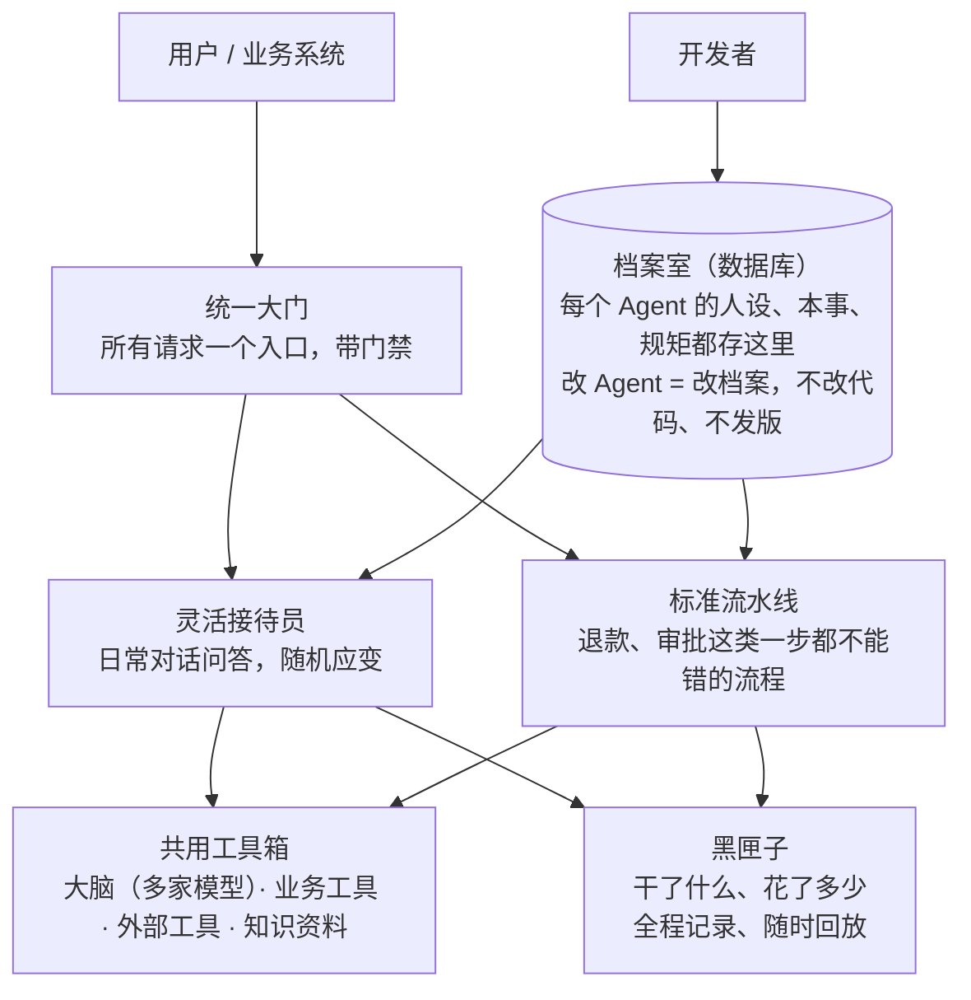
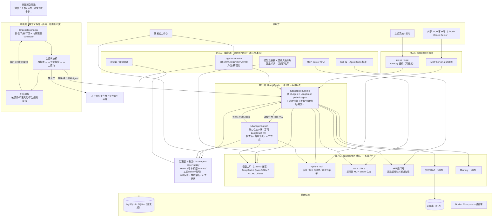
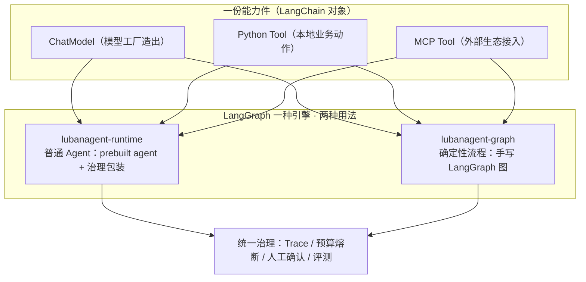
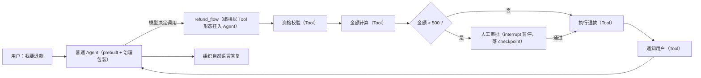
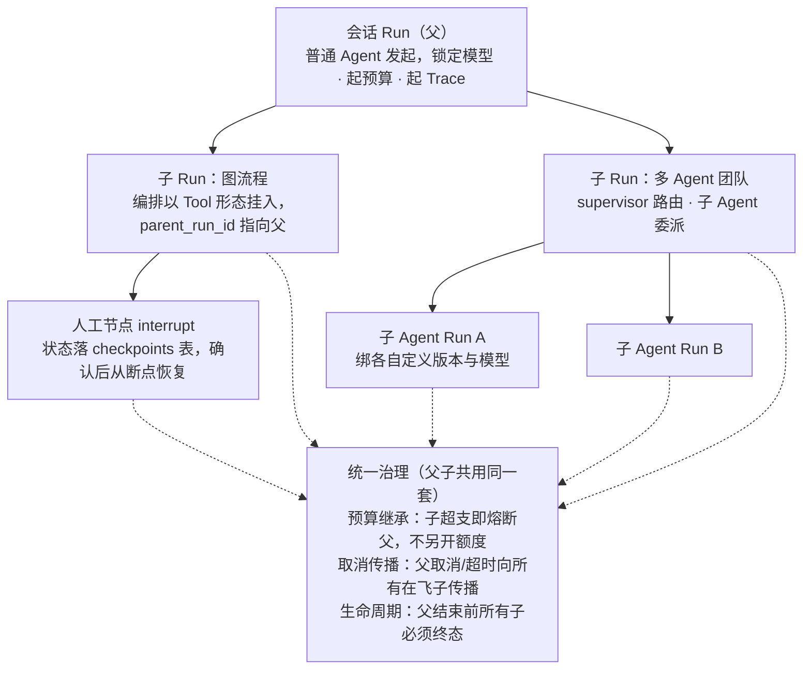
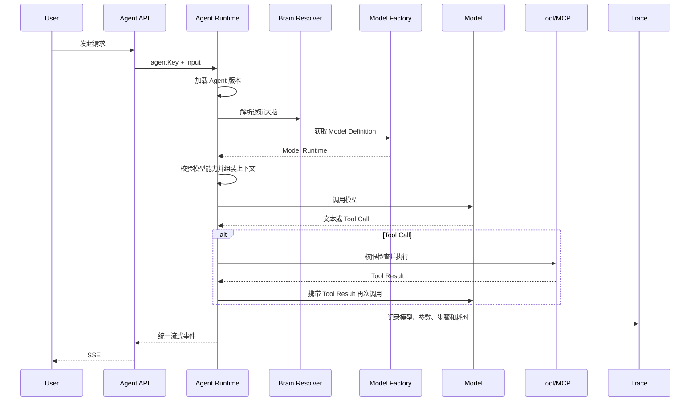

# LubanAgent 技术方案

> 文档状态：方案初稿  
> 上位文档：`../product-specs/LubanAgent-prd.md`（产品定位、目标用户、功能范围与差异化）  
> 产品形态：可直接克隆、运行、修改和独立部署的 Agent 基础工程仓库  
> 核心定位：专为 Agent 开发打造，帮助 Agent 开发者快速搭建可定制、可扩展、可测试的生产级 Agent 项目

## 总览：整体架构与技术栈



图里每个框的大白话与技术对照：

| 图里的框 | 大白话 | 技术对应（给工程师） |
| --- | --- | --- |
| 统一大门 | 所有请求从一个入口进出，有门禁 | FastAPI · REST/SSE · API Key 鉴权；MCP Server 暴露 |
| 档案室 | 每个 Agent 的"人事档案"：人设、本事、规矩；改档案就是改 Agent，不用改代码发版 | MySQL 8 / SQLite；定义、模型注册、Skill、测试集、Trace 全部入库版本化 |
| 灵活接待员 | 日常对话随机应变，自己决定用哪个工具 | LangGraph prebuilt agent + 治理包装（步数/预算/超时/Trace） |
| 标准流水线 | 必须按固定步骤走的流程，一步不能跳 | LangGraph 编排，检查点、人工节点 |
| 共用工具箱 | 大脑、工具、知识资料，接待员和流水线用同一套 | 模型工厂（OpenAI 兼容）· Python Tool · MCP · Skill · RAG · Memory |
| 黑匣子 | 干了什么、花了多少，全程记账，可回放、可考核 | Trace · 评测回归 · 成本熔断 · 人工确认 |

技术栈一览：

| 层 | 技术选型 | 备注 |
| --- | --- | --- |
| 语言 | Python ≥ 3.11 | |
| Agent 生态 | LangChain / LangGraph | 一个生态、同一套对象、一个引擎两种用法（见 10.5） |
| 模型接入 | OpenAI 兼容协议 | DeepSeek/Qwen/GLM/vLLM/Ollama 一套客户端全覆盖；连接信息存库、固定标识切换 |
| 工具生态 | MCP（官方 Python SDK） | Client 接生态；自有 Tool 反向暴露为 MCP Server |
| 能力包 | Agent Skills 开放标准（SKILL.md） | 渐进加载，入库版本化，不做公共市场 |
| 接入层 | FastAPI + SSE | API Key 可插拔鉴权 |
| 存储 | MySQL 8.0+ / SQLite（开发期免安装） | 定义、版本、Trace、评测、LangGraph checkpoint 统一落库 |
| 知识检索 | 最小 RAG（向量库可选）+ 防错答守门（相关度阈值/知识时效/全 miss 拒答短路） | 简单 Agent 默认不启用；守门由代码强制（`score_threshold`/`no_hit_fallback`/`max_age_days`），拒答可用评测 `expect_refusal` 硬指标回归 |
| 部署 | Docker Compose | 克隆即跑 |
| 消息渠道层（商用模块） | ChannelConnector Protocol + 官方 connector（微信/飞书/钉钉）+ 电商客服参考实现（京东/淘宝/拼多多） | 独立可拆卸模块，**开源版不含**；核心不依赖它，装上后接入外部消息流并走会话状态机/出站风控 |
| 许可证 | Apache-2.0（开源核心）；渠道层商用授权 | |

> 分层与模块关系详见第 6 章；LangChain 与 LangGraph 结合方式见 10.5；仓库模块划分见第 11 章。

## 1. 背景

企业后台项目的重复建设问题早已被各类成熟脚手架解决：用户、权限、配置、日志、监控、代码组织和基础页面不必从零开始。

Agent 领域还没有这样的基础工程，每个项目都在重复解决同一批问题：

- 接入和切换不同模型；
- 定义 Agent 的名字、职责、Prompt 和行为边界；
- 组织 Tool、MCP、知识库和 Memory；
- 处理模型与工具之间的多轮调用；
- 提供流式接口、运行轨迹、测试和部署能力；
- 避免模型厂商 SDK 侵入业务代码。

LubanAgent 的目标不是建设统一托管所有 Agent 的 SaaS 平台，而是提供一个完整代码仓库。Agent 开发者克隆仓库后，在自己的工程中定义 Agent、编写业务 Tool，并独立部署。

## 2. 产品定位

### 2.1 一句话定义

LubanAgent 是专为 Agent 开发打造的基础工程：一个已经打通模型、Agent、Tool、MCP、知识、记忆、流式接口、运行观察和测试链路的完整代码仓库。

它的服务对象不是“Python 开发者”，而是“Agent 开发者”——Python 是实现技术栈，Agent 开发的工程化才是产品本身。

### 2.2 目标用户

- 以交付生产级 Agent 应用为目标的 Agent 开发者；
- 需要在业务系统中落地客服、助手、分析或自动化 Agent 的企业团队；
- 对 Prompt 工程、Tool 设计、模型选型和运行治理有工程化诉求，希望站在完整基座上开发的团队；
- 希望保留完整源码、能够自行修改和部署的开发团队。

技术栈前提：工程基于 Python / LangChain 实现，适合以 Python 为主要开发语言的团队。Python 是实现手段而非产品定位——产品服务的是 Agent 开发本身。

### 2.3 产品边界

LubanAgent 是：

- 一个完整代码仓库；
- 一套 Agent 工程结构和开发规范；
- 一组可按需启用的基础能力；
- 一组可以直接运行和改造的示例 Agent；
- 一个面向 Agent 开发者的调试和观察环境。

LubanAgent 不是：

- 在线托管其他公司 Agent 的平台；
- 低代码 Agent 工作流平台；
- 模型、Prompt 或插件商城；
- 面向运营人员的知识库 SaaS；
- 通用 Web 后台脚手架（与 Agent 无关的应用底座）；
- 图片、视频、短剧等具体业务项目。

## 3. 建设目标

### 3.1 核心目标

1. 开发者克隆仓库、配置一个模型后，可以快速运行第一个 Agent。
2. Agent 的身份、Prompt、大脑、知识、记忆、工具和行为边界可以独立定义。
3. 模型是 Agent 可以动态选择和切换的大脑，业务代码不依赖具体模型厂商。
4. 每类模型允许通过固定工厂代码处理自身差异，不能被不完整的通用抽象限制。
5. 普通 Agent 保持简单、不引入编排；有强制步骤顺序的确定性业务流程用图编排做代码级强制。
6. 生成的项目具备继续开发、测试、观察和部署的完整基础，而不是只能运行 Demo。
7. 评测与成本治理是一级能力：每次运行可观测、可回归、可计量。

### 3.2 非目标

- 第一阶段不追求覆盖所有模型厂商；
- 第一阶段不建设可视化工作流设计器；
- 第一阶段不建设通用多 Agent 协作平台；
- 第一阶段不允许仅依靠 Prompt 承担权限和业务安全；
- 第一阶段不把模型厂商 SDK 的类型直接暴露给业务模块。

## 4. 典型使用场景

仓库内置一个智能客服 Agent 作为首个完整示例，但底层能力保持通用。

克隆后第一步（极简上手路径）：

```text
克隆仓库 -> 配一个模型（OpenAI 兼容，填连接信息到库）
  -> 跑客服示例（自带 Mock 业务服务，docker compose up）
  -> 改 Agent 定义（人设/Prompt/大脑，改库不发版）看效果
  -> 加自己的业务 Tool（app/tools/ 下一个 @tool 函数）
  -> 有固定步骤的流程就手写一张 graph（退款/审批）
```


```text
用户询问产品问题
  -> 检索产品知识
  -> 返回带来源的答案

用户询问订单状态
  -> 调用订单查询 Tool
  -> 返回业务结果

用户要求退款
  -> 判断是否进入确定性退款流程
  -> 必要时请求人工确认

无法解决
  -> 总结对话
  -> 转交人工客服
```

同一套基础能力更换 Agent 定义和业务 Tool 后，可以构建：

- HR 政策助手；
- 运维巡检助手；
- 销售辅助 Agent；
- 数据分析 Agent；
- 内部知识助手；
- 研发协作 Agent。

## 5. 总体能力

### 5.1 工程基座

工程只提供 Agent 运行所必需的最小基座，不内置与 Agent 无关的通用后台能力：

- 调用入口鉴权：REST / SSE 接口的 API Key 校验，供业务系统安全调用；
- 调用方治理：按 API Key 维度的速率限制与配额扩展点（`RateLimiter` Protocol，默认内存实现，可换 Redis），多业务系统共用一个核心时不裸奔；
- 环境化配置：开发、测试、生产环境隔离，支撑模型与参数的按环境映射；
- 运行持久化：会话、Run、Trace 和 Agent 版本的存储；
- Docker 化部署：一键打包，可选依赖（向量库、MCP Server）按需编排。

明确不内置用户、角色、权限等通用后台管理能力。Agent 运行在开发者的业务系统中，账号体系由业务系统自己解决；LubanAgent 保证接口可被安全调用即可。

### 5.2 Agent 定义

一个 Agent 由以下内容组成：

```text
Agent
= 身份
+ 指令
+ 大脑
+ 知识
+ 记忆
+ 能力
+ 行为边界
+ 输入输出契约
```

| 组成 | 主要内容 |
| --- | --- |
| 身份 | 唯一标识、名字、说明、角色定位、欢迎语 |
| 指令 | System Prompt、Prompt 模板、变量和输出要求；可直接内嵌，也可引用 Prompt 库（见下） |
| 大脑 | 默认模型、逻辑模型角色、备用模型和选择策略 |
| 知识 | 可访问知识库、检索策略和引用规则 |
| 记忆 | 会话窗口、摘要记忆、长期记忆策略 |
| 能力 | Python Tool、MCP Tool、Skill 能力包、其他受控业务能力 |
| 边界 | 权限、最大步数、预算、超时、拒答和人工接管 |
| 契约 | 输入类型、结构化输出、流式事件和错误格式 |

Agent 定义以数据库为运行期主存储，运行期可维护，并在库内版本化；YAML 用于初始化、导入导出。一次运行必须绑定明确的 Agent 版本，避免 Prompt 或模型配置更新后无法解释历史结果。

**Prompt 库（指令的双轨来源）**：Prompt 是独立版本化的一等实体（`prompts`/`prompt_versions` 表，与 Agent 定义同型：指针 + 不可变快照），以 Prompt 为维度草拟、发版、复用。Agent 定义通过 `prompt_key`/`prompt_version` 两个字段引用它；不引用（字段为空）= 纯内嵌 instructions，存量 Agent 与 YAML 导入路径零行为变化。引用的解析发生在**落库前**——服务端取 Prompt 当前版（或钉住版）把全文写入 instructions、变量合并进 Agent 自带变量，之后 `instructions` 始终是权威落地内容；Agent 版本快照因此内嵌 Prompt 全文，**运行期只读快照、不回查 prompts 表**（回放确定性）。Prompt 新版不会自动作用于引用方——Agent 要吃新版必须显式产生新的 Agent 版本。

版本兼容治理（版本化容易，版本间兼容才是难点）：

- 旧版本是不可变快照：发布即冻结，Prompt/大脑/边界字段锁定，回放历史 Run 永远拿到当时的定义；Prompt 同样在库内版本化（`prompts`/`prompt_versions`），Agent 快照内嵌解析后的 Prompt 全文，回放不回查 Prompt 库；
- 代码 Tool 是外部引用：Agent 版本只记 Tool 的注册键与签名摘要，不内联代码；Run 启动前校验签名——Tool 被删或签名漂移则该版本标记"不可运行"，拒绝新发起、保留历史回放；
- 进行中的 Run 绑定旧版本不受新版本影响；旧版本可被标记弃用但不可物理删除（有引用即留）；
- 版本演进只允许"加字段、宽松约束"，破坏性变更必须升主版本号并在 UPGRADE.md 给迁移指令。

### 5.3 模型中心

- 模型供应商连接信息与模型定义存数据库，运行期可维护；
- 模型以固定标识引用，切换模型 = 修改库中映射指向另一个标识，不改代码、不发版；
- 连接与适配代码集中在独立模型模块（模型工厂），新增厂商只动这一个模块；
- 配置具体模型及其固定使用参数；
- 声明模型支持的能力；
- 为模型建立 `fast`、`smart`、`cheap`、`vision` 等逻辑大脑角色；
- 支持按 Agent、按运行或按任务选择模型；
- 支持备用模型和受控降级；
- 记录实际使用的模型、参数、耗时和 Token。

### 5.4 Tool 与 MCP

- 支持开发者编写本地 Python Tool；
- 支持以 MCP Client 接入远程或本地 MCP Server（stdio / Streamable HTTP）；
- 支持把自有 Tool 以 MCP Server 形式反向暴露，供其他 Agent 与 IDE 调用；
- 支持 Tool 参数描述、返回值和错误规范；
- 支持按 Agent 绑定可使用的 Tool；
- 支持调用前权限检查、参数检查和风险判断；
- 支持超时、重试、幂等和人工确认；
- 支持 Tool 单独调试和 Mock。

### 5.5 Skill 能力包

- 兼容 Agent Skills 开放标准（SKILL.md 目录包：指令 + scripts/references/assets），存量标准 Skill 包零适配可用；
- 渐进加载：启动仅加载 name/description 元数据，任务命中后加载正文，再按需加载引用资源与脚本；
- Skill 入库并版本化，可按 Agent 分配；
- Skill 内脚本在受控环境执行（超时、网络白名单）；
- 不做 Skill 公共市场，仅本地目录与私有分发。

### 5.6 知识与记忆

- 支持 Agent 绑定一个或多个知识来源；
- 提供文档解析、分段、向量化和检索的标准扩展点；
- 支持检索结果引用和权限过滤；
- 区分完整会话历史、模型上下文和长期记忆；
- 允许不同 Agent 使用不同记忆策略；
- 允许关闭 RAG 和 Memory，避免简单项目被迫引入额外组件。

### 5.7 开发者工作台

仓库可附带一个轻量开发者工作台，用于：

- 编辑和调试 Agent 定义；
- 切换模型并比较结果；
- 管理 Prompt 库（草拟、发版、版本历史、分配给 Agent）；
- 调试 Prompt；
- 测试 Tool 和 MCP；
- 查看模型调用和工具调用轨迹；
- 重放历史输入；
- 运行 Agent 测试集；
- 查看 Token、耗时和错误。

工作台是开发辅助能力，不承担平台运营和多租户托管职责。

## 6. 总体技术框架



> **渠道层依赖方向（硬约束）**：渠道层 → 核心单向依赖（渠道层调用 Agent Runtime），核心 → 渠道层**禁止**。图中 `SSM --> RT` 是渠道层调用核心，核心不画指向渠道层的边。不装渠道层时，业务系统直接走 `BIZ --> API --> RT`（被动模式），核心独立可运行；装上渠道层后，外部消息经 `ChannelConnector → 会话状态机 → Runtime → 出站风控 → 回复`（主动模式）。核心只定义 `ChannelConnector` Protocol 等扩展点，渠道层实现可整体替换或卸载。

整体分为五层加一条横切，外加一个可拆卸的渠道层：

1. **接入层**：REST / SSE 调用入口（API Key 可插拔鉴权）；MCP Server 反向暴露端点；
2. **定义层（数据库）**：Agent 定义、模型注册与大脑映射、Skill 库、MCP 登记、测试集，全部入库、版本化、运行期可维护——运营期可变的不在代码里；
3. **执行层（LangGraph 一种引擎 · 两种用法）**：普通 Agent = LangGraph prebuilt agent 外套治理包装（步数/预算/超时/取消/Trace）；确定性流程 = 手写 LangGraph 图（流水线/检查点/人工节点）；编排 Run 作为子 Run 挂入会话 Run；
4. **能力层**：LangChain 对象一份能力件——模型工厂（OpenAI 兼容）、Python Tool、MCP Client、Skill 运行时、RAG、Memory，两种用法复用同一份；
5. **治理层（横切）**：Trace、评测回归、成本熔断、人工确认，罩在两种执行模式之上；
6. **基础设施**：MySQL 8（开发期 SQLite）、可选向量库、Docker Compose 一键部署；
7. **渠道层（可拆卸 · 商用）**：独立模块，开源版不含。对接外部消息渠道（IM + 电商客服），提供统一消息模型、会话状态机、出站风控。**依赖方向单向：渠道层 → 核心（调用 Agent Runtime），核心 → 渠道层禁止**。不装渠道层时核心通过接入层被动提供服务；装上后核心被渠道层驱动主动接待外部消息。核心只暴露 `ChannelConnector` Protocol、会话状态抽象、出站拦截 Hook 等扩展点，渠道层实现可整体替换或卸载。

## 7. 模型工厂与动态大脑

### 7.1 核心认识

模型不是插件，而是 Agent 可以选择和切换的大脑。

不同模型虽然都可以完成消息输入和文本输出，但它们在以下方面并不完全一致：

- Tool Calling 协议和参数；
- 结构化输出能力；
- 多模态消息格式；
- 思考模式和推理参数；
- 流式事件格式；
- Token 统计方式；
- 上下文长度和最大输出；
- 厂商扩展参数和错误码。

因此，LubanAgent 不采用“一个通用 Builder 解决所有模型”的假设。

### 7.2 模型接入结构

模型体系分为四个概念：

| 概念 | 说明 |
| --- | --- |
| Model Provider | 一个模型供应商或兼容服务的连接配置 |
| Model Definition | 一个具体可使用模型及其参数、能力和工厂绑定 |
| Brain Profile | Agent 引用的逻辑大脑，例如 `smart` 或 `fast` |
| Model Runtime | 模型工厂根据配置创建或复用的实际运行实例 |

模型调用链路为：

```text
Agent Definition
  -> Brain Profile
  -> Model Definition
  -> Model Factory Registry
  -> 对应模型的固定工厂代码
  -> Model Runtime
```

### 7.3 模型工厂

每种模型接入都必须有明确、可维护的工厂代码，负责：

- 读取该模型的标准配置和专属配置；
- 创建同步或流式模型实例；
- 配置 HTTP 客户端、鉴权、超时和重试；
- 转换模型专属请求参数；
- 声明模型能力；
- 统一错误和使用量信息；
- 必要时保留模型原生扩展能力。

OpenAI Compatible 模型可以复用公共工厂基础，但仍然需要注册为独立的 Model Definition。对于行为不兼容的模型，使用专属工厂代码，不在业务层堆积条件判断。

**`params` 字段双语义契约**：`ModelDefinition.params` 同时承载两类字段，工厂必须分流，不得整体透传给底层模型客户端——

- **模型构造参数**：`temperature`、`max_tokens`、`top_p` 等，透传给 `ChatOpenAI` 构造器；
- **框架计费字段**：`input_price_per_1k`、`output_price_per_1k`（每千 token 单价），由 `BudgetGuard` 读取做费用归因（§成本治理），**不是** `ChatOpenAI` 的合法入参。

`model/openai_compat.py` 构造 `ChatOpenAI` 前摘除 `_FRAMEWORK_RESERVED_PARAMS`（当前为上述两个计费字段）；新增框架自消费的 `params` 字段须同时登记进该保留集合，否则会被 SDK 拒收（`TypeError`）。

LubanAgent 的 Agent 循环、Tool、MCP、Memory 和 RAG 均基于 LangChain 构建，业务代码直接面向 LangChain 的编程模型开发；模型工厂只负责收敛 LangChain 之上“不完全通用”的部分——各模型的创建、参数与能力差异。需要隔离的是模型厂商 SDK，不是 LangChain。

### 7.4 模型能力声明

每个 Model Definition 至少声明以下能力：

```text
chat
streaming
tool_calling
structured_output
vision
reasoning
context_window
max_output
```

Agent 启动前进行能力匹配。例如 Agent 绑定了 Tool，但当前大脑不支持 Tool Calling，应当拒绝启动或切换到符合要求的备用模型，而不是运行到中途才失败。

### 7.5 动态切换

模型动态切换分为四个层次：

1. **按 Agent 切换**：不同 Agent 选择不同默认大脑。
2. **按环境切换**：开发、测试、生产环境映射到不同实际模型。
3. **按运行切换**：在权限允许的情况下，为单次运行指定模型。
4. **按任务切换**：规划、执行、总结或视觉识别使用不同大脑。

默认策略是一次 Agent Run 锁定实际模型，保证行为和审计一致。只有显式配置了任务路由时，才允许在一次 Run 内切换模型，并且每一步都必须记录实际模型。

### 7.6 逻辑大脑

Agent 优先绑定逻辑角色，而不是硬编码厂商模型名：

```text
fast   -> 当前环境的快速模型
smart  -> 当前环境的高质量模型
cheap  -> 当前环境的低成本模型
vision -> 当前环境的多模态模型
```

这样更换厂商或模型版本时，不需要修改 Agent 业务代码和 Prompt 文件。

### 7.7 降级与故障切换

模型切换不能只根据调用失败盲目重试。需要考虑：

- 备用模型是否满足 Agent 所需能力；
- 不同模型的 Prompt 和结构化输出是否兼容；
- 切换后是否允许继续使用原会话上下文；
- 是否会跨越企业数据合规边界；
- 是否超过本次运行预算。

模型路由和故障切换必须是显式策略，并写入 Trace。

### 7.8 模型分类

“Agent 大脑”主要指 Chat、Reasoning 和 Multimodal 模型。Embedding、Rerank 等属于知识处理的辅助模型，也通过模型工厂管理，但不作为 Agent 主大脑参与普通对话循环。

## 8. Agent Runtime

Agent Runtime 是仓库的统一运行入口，负责：

- 加载指定版本的 Agent Definition；
- 解析逻辑大脑并校验模型能力；
- 组装 Prompt、会话上下文、知识和 Tool；
- **基于 LangGraph prebuilt agent 执行模型↔工具循环**（不重写循环，跟随生态升级）；
- 在外层控制最大步数、Token、超时和取消（治理包装）；
- 输出统一流式事件；
- 记录每次模型和 Tool 调用；
- 在需要时进入人工确认或图流程。

Runtime 不应默认等同于“多 Agent Supervisor”。普通 Agent 的主流程应当简单、可解释——循环本身由 prebuilt agent 承担，治理在外层：

```text
准备上下文（KV-cache 友好）
  -> 治理包装：校验能力 / 起预算 / 起 Trace
  -> prebuilt agent 循环：
       调用模型
       模型返回最终结果：结束
       模型请求 Tool：检查并执行 Tool
       将 Tool 结果加入上下文
       再次调用模型
  -> 治理包装：步数/预算/超时三道硬边界全程守门
```

## 9. 配置、扩展与业务代码的边界

| 层次 | 适合承载的内容 |
| --- | --- |
| 配置 | Agent 名字、Prompt、逻辑大脑、知识、已启用 Tool、运行参数 |
| 工厂扩展 | 新模型接入、模型专属参数和能力差异 |
| 能力扩展 | Python Tool、MCP、知识连接器、Memory 策略 |
| 业务代码 | 订单、退款、审批、权限校验等确定性业务规则 |

核心原则：

> 配置解决差异，工厂解决模型接入，能力扩展解决外部连接，代码解决业务。

Prompt 不得替代权限、金额校验、状态检查和审批等确定性规则。

## 10. LangChain 与 LangGraph 分工

### 10.1 两者的角色

在 Python 官方生态中，LangChain 是高层 Agent 框架，LangGraph 是负责持久运行、状态、流式输出和人工介入的低层编排运行时，二者并不是同层替代关系。

本工程直接采用官方 Python 生态的 LangChain 与 LangGraph：

| 方案 | 适合解决的问题 |
| --- | --- |
| LangChain | 模型接入、消息、Tool Calling、MCP、Memory、RAG 基础能力 |
| LangGraph | 状态图、确定性流程、条件分支、检查点、暂停恢复、多 Agent 编排 |

### 10.2 选型结论

1. 主仓库基于 LangChain 构建 Agent 核心能力，业务代码直接使用其编程模型。
2. **一个引擎、两种用法**：普通 Agent 与确定性流程都跑在 LangGraph 之上——普通 Agent 直接用 LangGraph prebuilt agent（`create_react_agent`）做模型↔工具循环，自有 Runtime 只在外层套治理（步数/预算/超时/取消/能力匹配/Trace/SSE），不重写 Agent 循环；确定性流程手写 LangGraph 图。这样跟随生态升级、不背循环维护债。
3. 普通 Agent 不需要用户编写图——全部要素在定义层配置，循环由 prebuilt agent 承担，治理包装是框架内部细节。
4. LangGraph 作为独立模块按需引入：业务流程有强制步骤顺序时（退款、审批），必须用手写图做代码级强制，流程正确性不交给 Prompt 或 Skill；普通对话型 Agent 走 prebuilt + 治理包装，用户不写图。
5. LubanAgent 自有领域契约只承载 LangChain 没有的产品概念（Agent Definition、Brain Profile、Run、Trace）；业务模块不直接依赖模型厂商 SDK。

### 10.3 使用边界

```text
普通客服问答
Tool Agent
MCP Agent
RAG Agent
  -> LangChain 基础能力

身份验证 -> 查询订单 -> 判断资格 -> 人工审批 -> 执行退款
长时间运行任务
确定性步骤与 Agent 步骤混合
  -> LangChain + 可选 LangGraph
```

LangGraph 不是默认依赖，原因不是它没有价值，而是脚手架首先要让简单 Agent 保持简单。反过来，在确定性业务流程（退款、审批）里编排是必需品，不是选配。

### 10.4 与 LangGraph 的层次关系

LangGraph 官方定位是低层编排运行时（durable execution、streaming、human-in-the-loop、persistence）：流程拓扑必须用代码定义，它本身不是脚手架，也不提供 Agent 定义层。LangChain 官方把平台层（Trace、评测、部署）做成了 LangSmith（外挂 SaaS）。

LubanAgent 的层次是：脚手架（工程基座）+ Agent 定义层（配置层）。

- 普通 Agent：全部要素（身份、指令、大脑、知识、记忆、能力、边界、契约）在定义层配置生成，不编写图；更换 Agent 类型等于更换定义，不改代码、不发版；
- 确定性业务流程：显式编写 LangGraph 图（流水线、检查点、人工节点），同样接受治理、Trace 与评测；
- 企业含义：Agent 变更不发版、定义可审计、治理统一在定义层执行，且观测数据不依赖外部 SaaS。

### 10.5 结合方式：一个生态，一个引擎两种用法

LangChain 与 LangGraph 不是两个需要对接的框架：LangGraph 构建于 langchain-core 之上，消息、模型、工具是同一套类，不存在适配层。LubanAgent 不重写 Agent 循环，而是统一跑在 LangGraph 之上，按用法分两种：

- **普通 Agent（prebuilt + 治理包装）**：模型↔工具循环由 LangGraph prebuilt agent（`create_react_agent`）承担，`lubanagent-runtime` 在外层套治理包装——步数/预算/超时/取消、启动前能力匹配、统一 SSE 事件、Trace 落库。治理包装是框架内部细节，用户只配定义、不写图。
- **确定性流程（手写图）**：`lubanagent-graph` 暴露图 DSL，用户为退款/审批等强制步骤顺序的流程手写 LangGraph 图。

两种用法共享同一份能力件与治理，区别只在"循环是 prebuilt 给的"还是"图是用户写的"。



结合只有三种形态：

1. **节点 = Tool**：确定性步骤，节点内调用一个治理过的 Tool；
2. **节点 = Agent**：该步骤需要模型判断，节点内跑一次普通 Agent（prebuilt + 治理包装，仍走大脑解析与治理）；
3. **流程 = Tool**（关键方向）：整条流水线注册为 Agent 的一个 Tool——什么时候进流程由模型决定，进了流程每一步由代码保证。

以退款为例：



工程约定：

- 编排 Run 是会话 Run 的子 Run，节点每次流转写 Trace，可整体回放（子 Run 契约见 §10.6）；
- LangGraph checkpointer 落本工程自有 DB（开发期 SQLite / 生产 MySQL 均可），不引外部服务；
- 普通 Agent 循环由 LangGraph prebuilt agent 承担，治理包装在外层；用户不为普通 Agent 写图；
- 节点函数是普通 Python，直接复用模型工厂产物与 Tool 注册表，无第二份模型/工具配置。

### 10.6 子 Run 契约（编排 Run 与会话 Run 的关系）

多 Agent 编排、图流程、节点内 Agent 调用都产生子 Run。子 Run 不是独立 Run，必须遵守以下契约，保证整条编排可治理、可回放、可熔断：

| 维度 | 契约 |
| --- | --- |
| 父子关联 | 子 Run 携带 `parent_run_id`（`RunRow.parent_run_id`）；Trace 按树形组织，可整体回放也可单节点下钻，成本按 `parent_run_id` 逐层 BFS 归集 |
| 预算继承 | 子 Run 从父 Run 继承剩余预算池，不另开额度；子 Run 超支即触发父 Run 熔断，不允许"子 Run 烧完父 Run 继续" |
| 取消传播 | 父 Run 取消/超时向所有在飞子 Run 传播；子 Run 不可取消父 Run |
| Trace 上下文 | Trace 上下文（Agent 版本、实际模型、调用方身份）跨执行器透传，节点内 Agent 调用绑定各自定义版本与模型，不串台 |
| 人工确认 | 子 Run 内的人工暂停挂在自己的 checkpoint，恢复由父 Run 驱动；不阻塞兄弟节点以外的链路 |
| 生命周期 | 子 Run 状态机是父 Run 状态机的子集；父 Run 结束前所有子 Run 必须终态（completed/failed/cancelled） |

> 这张表是双执行器治理一致性的落地契约：普通 Agent Run 与编排 Run 共用同一套治理，靠的就是子 Run 不破预算继承与取消传播这两条。



> 图中树形关系只靠 `parent_run_id` 一列表达：Trace 树形回放与成本逐层归集（`own` 与后代明示分开、不重复相加）都由它 BFS 推导，不另设 root 列。

## 11. 仓库结构建议

以下为职责层面的建议，不代表最终 Python 包划分必须完全一一对应：

```text
lubanagent
├── lubanagent-app                应用启动与调用入口（REST / SSE）
├── lubanagent-common             通用工具与基础配置
├── lubanagent-core               Agent 稳定领域模型和公共契约
├── lubanagent-model              模型定义、工厂、注册和大脑解析
├── lubanagent-runtime            普通 Agent：LangGraph prebuilt agent + 治理包装
├── lubanagent-tool               Python Tool 和执行治理
├── lubanagent-mcp                MCP 接入（Client）与反向暴露（Server）
├── lubanagent-skill              Skill 能力包（Agent Skills 标准）
├── lubanagent-knowledge          RAG 与知识扩展
├── lubanagent-memory             会话和长期记忆
├── lubanagent-graph              图编排（确定性业务流程）
├── lubanagent-observability      Trace、指标、测试和评测
├── lubanagent-demo               智能客服等示例
├── lubanagent-ui                 开发者工作台
└── lubanagent-channels           【商用·独立可拆卸模块】消息渠道层：ChannelConnector 实现（微信/飞书/钉钉 + 电商客服）、会话状态机、出站风控；开源版不含、不进开源仓库；核心通过 ChannelConnector Protocol 对接，不依赖此模块
```

模块拆分的目标是隔离职责和可选依赖，不追求模块数量。第一版可以合并实现，但依赖方向必须保持清晰。

当前第一版为**单包 `lubanagent` + 子模块**实现（实际子模块：`api`/`app`/`cli`/`config`/`core`/`extension`/`graph`/`knowledge`/`mcp`/`memory`/`model`/`multiagent`/`observability`/`persistence`/`runtime`/`skill`/`tool`/`ui`），上表的 `lubanagent-*` 连字符名是逻辑职责划分而非物理独立包。其中：`lubanagent-common` 实际对应 `config` + `core`；`lubanagent-demo` 实际是顶层 `demos/` 目录（不在 `lubanagent/` 内）；多 Agent 编排作为一等卖点对应实际存在的 `multiagent` 子模块。渠道层 `lubanagent-channels` 为独立可拆卸商用模块，不在 `lubanagent/` 内。

**渠道层是独立可拆卸模块（商用）**：`lubanagent-channels` 不进开源仓库，与开源核心（`lubanagent-*` 其余模块）物理隔离。核心的 `ChannelConnector` Protocol、会话状态抽象、出站拦截 Hook 定义在开源核心的扩展点模块里；渠道层只负责实现这些 Protocol 并调用核心 Runtime。import-linter 只守卫禁止方向：`lubanagent → lubanagent_channels` 禁止（`lubanagent_channels → lubanagent` 允许是无 forbidden 规则的隐式放行，非显式 guard）。命名上，import-linter 用 Python 包名 `lubanagent_channels`（下划线），分发名用 `lubanagent-channels`（连字符）。开源用户不装渠道层也能完整运行核心（被动模式）。

## 11.1 开发方法论：spec-coding skill

仓库根 `.claude/skills/spec-coding/` 内置规格驱动开发 skill，克隆即用，是「若依式起步基座」的方法论成色——基座不只给运行骨架，还给可复用的开发纪律。

- **正向（spec→code，默认）**：从规格文档（PRD/技术方案/架构/开发计划）提取开发单元契约（接口签名 / 数据模型 / 行为步骤 / 边界硬约束 / 验收标准），按契约编码，独立 strict-validation subagent 校验「代码是否符合 spec 契约、是否违反边界、验收是否真通过」，默认 FAIL，迭代至 PASS。
- **逆向（code→docs，同步）**：代码稳定或演进后扫描真实代码回写 `docs/`，校验「文档 vs 代码事实一致」，消除文档漂移。

skill 含 `SKILL.md`（双路径主流程）、`references/`（正向契约提取指南 + 逆向文档取证指南 + 严格验证 reviewer）、`scripts/verify.sh`（最低门槛）、`assets/`（文档模板，带 TEMPLATE-LOCK 章节锁）。无内部依赖、语言无关。既是开发本仓库自身的纪律，也是用户开发自己 Agent 的可复用方法论。详细流程见 skill 内文档。

## 12. 核心运行流程



## 13. 非功能要求

### 13.1 可扩展性

- 新模型接入不修改 Agent 业务代码；
- 新 Tool 不修改 Agent Runtime；
- RAG、Memory、Graph 可以按需启用；
- 模型厂商特性可以保留，不被最低公共能力限制。

### 13.2 安全性

- API Key 不以明文返回前端，不进入普通日志；
- Tool 权限在每次执行时校验，而不是只在管理页面校验；
- 默认不提供任意 SQL、任意文件或任意命令执行能力；
- 高风险 Tool 支持人工确认；
- 检索结果和外部内容视为不可信输入；
- 模型切换不能绕过数据合规边界。

### 13.3 可观察性

每次 Run 至少可以回答：

- 使用了哪个 Agent 版本；
- 逻辑大脑最终解析为哪个实际模型；
- 模型调用了几次；
- 使用了哪些 Prompt 和知识；
- 调用了哪些 Tool，输入输出是什么；
- 消耗了多少 Token、时间和费用；
- 为什么结束、失败或切换模型。

### 13.4 可测试性

- 模型可以使用 Fake 或录制结果替代；
- Tool 可以独立进行单元测试；
- Agent 可以基于固定数据集回归测试；
- Prompt 和模型切换前可以比较结果；
- Graph 流程需要验证暂停、恢复和失败重试。

### 13.5 可维护性

- Agent Definition、Prompt 和模型配置必须版本化；
- 业务模块不直接依赖厂商 SDK；
- 通用逻辑和模型专属逻辑分离；
- 示例代码不得成为运行时硬编码逻辑。

### 13.6 成本治理

- 上下文组装尽力保持 KV-cache 友好：系统 Prompt 与工具定义放稳定前缀，消息流 append-only，动态信息（Tool 结果、检索片段）后置注入；这是尽力而为而非硬不变量——动态注入必然扰动前缀，实际命中取决于厂商缓存语义，不做过度承诺；
- 模型调用前进行 Token 估算（近似值），超过本次运行预算立即熔断；
- 失败重试必须有补偿与退避策略，避免失控重试烧钱；
- 每次 Run 的 Token、费用、预算与实耗写入 Trace，可审计。

### 13.7 并发模型与一致性

- FastAPI 入口全 async；LangChain 优先走 async API（`ainvoke`/`astream`），模型与 Tool 调用不阻塞事件循环；
- 同步厂商 SDK 或阻塞式 Tool 经 `anyio.to_thread` 卸载到线程池，不直接在 async 路径里同步 await 阻塞调用；
- 一次 Run 内的模型↔工具循环串行（步数有依赖），并发只发生在"多业务系统同时发起不同 Run"和"多 Agent 编排的独立子节点"两处；子节点并发受子 Run 预算池约束（§10.6）；
- 取消通过取消令牌传播，超时由治理包装兜底，二者触发后正在飞的模型/Tool 调用尽力中止并写结束原因。

## 14. 实现范围与顺序

**功能不分期，由 AI 一次性交付完整能力。** 不按人工投入收缩范围，仅按构建依赖排序实现——这是工程依赖决定的顺序，与"做到哪算哪"无关。

**第一步：核心领地与工程基座**

- 主仓库与工程基座（调用入口、环境配置、持久化、Docker 部署）；
- Agent Definition（身份/指令/大脑/知识/记忆/能力/边界/契约，存库、版本化）；
- Prompt 库（`prompts`/`prompt_versions` 表，独立版本化的一等实体；Agent 定义可双轨引用，落库前解析进版本快照）；
- Model Definition、Model Factory、Model Registry，OpenAI 兼容接入国内主流厂商与私有化部署；
- 逻辑大脑与按 Agent/环境动态切换、能力匹配与受控降级；
- 普通 Agent Tool Calling 循环（步数/预算/超时/取消、SSE）；
- Python Tool、MCP Client、基础 Trace 与测试样例。

**第二步：能力层与治理层**

- 评测体系：测试集、规则断言、LLM-as-judge 评分、回归测试与录制重放、A/B 对比；
- 成本治理：KV-cache 友好上下文组装、Token 估算、运行预算与熔断、成本分析；
- Tool/MCP 治理（权限、人工确认、超时/重试/幂等、独立调试与 Mock）；
- MCP Server 反向暴露。

**第三步：上层编排与扩展能力**

- 知识库与最小 RAG、Memory 策略；
- Skill 运行时（Agent Skills 标准兼容、入库版本化、按 Agent 分配）；
- 图编排（LangGraph）：流水线、检查点、暂停恢复、人工节点，确定性流程与 Agent 节点混合；
- 多 Agent 协作：supervisor / 子 Agent 委派、共享状态、任务路由，编排 Run 与单 Agent Run 同治理；
- 开发者工作台：定义编辑调试、模型对比、Prompt 调试、Tool/MCP 测试、Trace 查看；
- 长任务与异步运行。

**验收标准**：开发者克隆仓库、配置模型后 30 分钟内跑通客服示例，并通过修改 Agent 定义、Prompt、逻辑大脑和 Tool 构建新的 Agent；示例自带测试集可回归；退款流水线与多 Agent 协作均有可跑示例。运行期可选能力（RAG、Memory、图编排、多 Agent）默认不启用，简单 Agent 不被拖累，但均为一等能力。

## 15. 主要风险与应对

| 风险 | 应对 |
| --- | --- |
| LangChain/LangGraph 版本快速演进带来升级成本 | 模型创建与厂商适配收敛在模型工厂等少数模块，锁定主版本并跟随社区节奏升级 |
| 强行统一不同模型 | 公共配置加模型专属配置，每类模型保留固定工厂代码 |
| 动态切换导致结果不可追溯 | Run 锁定模型，所有路由和切换写入 Trace |
| 功能持续膨胀成平台 | 坚持代码仓库定位，工作台只服务开发和调试 |
| 简单项目被复杂编排拖累 | Graph、RAG、长期记忆均为可选能力 |
| Prompt 承担业务安全 | 权限、审批和业务规则必须由确定性代码执行 |
| 示例代码侵入核心 | Demo 仅依赖公共能力，核心模块不得反向依赖 Demo |
| 渠道层不开源被质疑"开源不彻底" | 明确边界：开源核心是通用 Agent 本体（任何渠道都用得上），渠道层是面向特定消息渠道的持续维护（IM/电商接口频繁变更）；核心可独立运行、留扩展点，不构成 vendor lock-in；商用渠道层是可选增强非必需 |
| 渠道层与核心耦合、无法真正拆卸 | 架构硬约束 + import-linter 守卫禁止方向（`lubanagent → lubanagent_channels` 禁止，允许方向为无 forbidden 规则的隐式放行）；核心只定义 Protocol（ChannelConnector、会话状态抽象、出站拦截 Hook），实现可整体替换或卸载 |

## 16. 决策记录（原待确认事项，已全部定案）

1. 一期模型：通过 OpenAI 兼容模式接入国内主流厂商（DeepSeek、Qwen、GLM 等）与私有化部署（vLLM、Ollama）；原生工厂按需在后续版本补充；
2. Agent Definition 首版字段按 PRD F1（身份、指令、大脑、知识、记忆、能力、行为边界、输入输出契约）；
3. Agent 定义维护：配置 + 数据库——定义存于数据库、运行期可维护、库内版本化，YAML 用于初始化与导入导出，业务 Tool 用 Python 代码实现；
4. 首版包含最小 RAG（单知识库、文档解析、向量检索、引用）；
5. 智能客服示例使用内置 Mock 业务服务（订单、退款、产品库），克隆即可跑；
6. 调用入口鉴权：API Key + 可插拔（可替换、可关闭，方便接入业务网关）；
7. 版本基线：Python ≥ 3.11；数据库 MySQL 8.0+，开发期支持 SQLite 免安装；
8. 评测与成本治理全量交付（AI 开发，不按人工投入收缩范围），宣传口径为“可用的评测起点”；
9. MCP 双向：Client 接外部 MCP Server 生态、自有 Tool 反向暴露为 MCP Server，二者均交付；Skill 能力包兼容 Agent Skills 开放标准（SKILL.md、渐进加载、入库版本化、按 Agent 分配），不做公共市场；
10. 图编排（确定性业务流程标配）：固定步骤顺序的流程必须用 LangGraph 流水线做代码级强制，Skill/Prompt 不承担流程正确性；
11. 多 Agent 协作：基于 LangGraph 的受控多 Agent 编排（supervisor / 子 Agent 委派、共享状态、任务路由）是一等卖点，与“若依式起步基座”不冲突——LangGraph 给引擎，LubanAgent 组装完整工程基座；编排 Run 与单 Agent Run 同库同治理同部署；长任务异步一并交付。代码优先，不做可视化编排平台。
12. **交付形态：开源核心 + 商用渠道层**：Agent 本体（F1-F13）为开源核心（Apache-2.0）；消息渠道接入（F14）、会话状态机（F15）、出站风控（F16）为独立可拆卸的渠道层模块，**开源版不含、商用版提供**，不进开源仓库。架构硬约束：核心不依赖渠道层（业务系统走 REST/SSE 调用即独立运行），渠道层单向依赖核心（`lubanagent-channels → lubanagent` 允许，反向禁止，import-linter 守卫）；核心只定义 `ChannelConnector` Protocol、会话状态抽象、出站拦截 Hook 等扩展点。渠道层不开源的理由：IM/电商渠道接口与规则频繁变更、维护成本高，不宜作开源社区资产，作为商用商品承载该维护。真实需求印证：自研 AI 客服接入主流电商平台方案中 Agent 本体仅占约 1/6 工作量，渠道接入/会话状态/出站风控占 5/6——渠道层即这 5/6 的商品化沉淀。

## 17. 结论

LubanAgent 的核心不是模型聊天页面，也不是 Agent 托管平台，更不是“给 Python 开发者用的 Agent 插件”，而是一套专为 Agent 开发打造、可以被开发者直接拿走、修改和部署的基础工程。

技术路线基于 LangChain 构建：Agent 循环、Tool、MCP、Memory 和 RAG 直接使用其成熟能力；模型工厂在其之上显式收敛不同模型的创建与参数差异；LubanAgent 自有领域契约只承载 LangChain 没有的产品概念；Agent 通过逻辑大脑实现动态切换；执行层统一跑在 LangGraph 之上——普通 Agent 用 prebuilt agent + 治理包装，确定性流程手写图，一个引擎两种用法，不重写循环、不背维护债。

最终要达到的效果是：

> Agent 开发者不再花时间重复搭建工程基础设施，而是尽快开始定义自己的 Agent、接入业务 Tool，并验证真实业务价值。

## 参考资料

- [LangChain 官方：Frameworks, runtimes, and harnesses](https://docs.langchain.com/oss/python/concepts/products)
- [LangChain 官方：Agents](https://docs.langchain.com/oss/python/langchain/agents)
- [LangChain 官方：Model Context Protocol](https://docs.langchain.com/oss/python/langchain/mcp)
- [LangGraph 官方文档](https://docs.langchain.com/oss/python/langgraph/overview)
