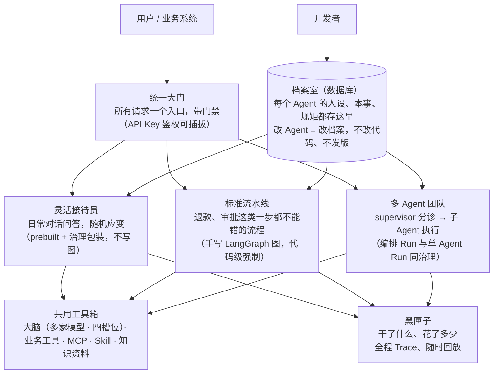
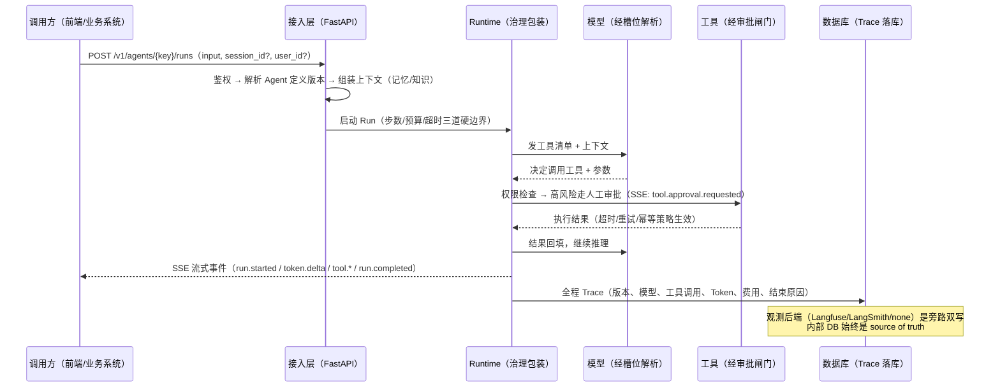
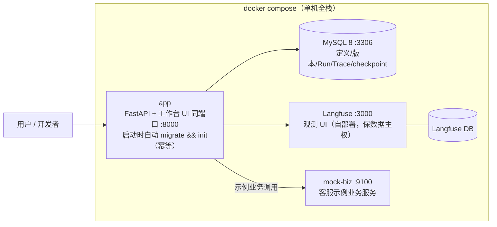

# 项目架构

> 这一页用四张图回答：系统分几层、你和框架各住哪里、一次 Run 数据怎么流、部署长什么样。模块级细节（接口/数据/行为/边界）见 `docs/specs/`（开发文档）；这里只讲你改造系统必须知道的部分。

## 图 1：系统分层



三种执行形态共用同一份能力件与治理——这是"一个引擎两种用法（加一层多 Agent）"：普通 Agent 不写图，确定性流程写图，多 Agent 是图之上的 supervisor 拓扑。

## 图 2：领地与目录（你住哪里，框架住哪里）

```text
LubanAgent/
├── lubanagent/    框架领地 —— 上游追踪，你原则上不动
│   ├── api/         FastAPI 接入层（路由 / 鉴权 / 错误映射 / OpenAPI 契约）
│   ├── core/        领域模型与扩展点协议
│   ├── model/       模型工厂（厂商适配只收敛在这里）
│   ├── runtime/     Agent 循环 / 治理包装 / SSE
│   ├── tool/        工具执行与审批闸门
│   ├── skill/       Skill 加载与沙箱
│   ├── knowledge/   最小 RAG
│   ├── graph/       图编排执行器
│   ├── multiagent/  supervisor 委派
│   ├── persistence/ ORM / 仓储 / 迁移
│   ├── observability/ Trace / 成本 / 评测 / 观测后端适配
│   ├── mcp/         MCP Client / Server
│   ├── cli/         luban 命令行
│   └── ui/          开发者工作台前端
├── app/           你的领地 —— 你的 Agent / Tool / 图 / 团队 / 配置都放这里，上游永不主动触碰
│   ├── agents/      Agent YAML（初始化导入用）
│   ├── tools/       你的业务工具
│   ├── graphs/      你的确定性流程（约定扫描入口）
│   ├── skills/      你的 Skill 包
│   └── config/      环境配置（.env）
├── website/       用户文档站（教程 + 手册，VitePress，独立部署）
├── docs/          开发用文档（设计文档 / 模块规格 / 契约）——面向贡献者与 AI 协作工具
├── demos/         内置客服示例（活文档）
├── tests/  migrations/  docker/  scripts/   共享领地
```

依赖方向单向：`app/* → lubanagent/*` 允许；`lubanagent/* → app/*` **禁止**——框架运行期通过 Registry 找用户扩展（import 即注册），不反向 import。两条 CI 守卫：

- **import-linter**：拦依赖反向；
- **`.lubanagent-upstream` 守卫**：上游改动命中 user-owned 路径时 CI 拦截。

这是"克隆改造后还能跟上游升级"的根本，详见[改造总览](./customization/overview.md)与[跟上游升级](./customization/upgrade.md)。

## 图 3：一次 Run 的数据流



每个环节的事件名与字段，见 [SSE 事件与错误码](./api/sse-and-errors.md)。

## 图 4：部署拓扑（Docker Compose 五服务）



镜像内三阶段构建：node 打工作台前端 → venv → 运行时。生产环境的必要改动（鉴权、真实凭证、持久卷、改 Langfuse 密码）见[部署与生产清单](./deploy.md)。

## 设计原则速查

| 原则 | 一句话 | 体现在 |
| --- | --- | --- |
| 定义入库版本化 | Agent = 数据库记录，改配置不发版 | [Agent 定义](./features/agent-definition.md) |
| 逻辑大脑解耦 | 换模型 = 改库映射，不改代码 | [模型工厂](./features/models.md) |
| 确定性规则由代码执行 | 权限/金额/审批不靠 Prompt 声明 | [Tool 与 MCP](./features/tools-mcp.md)、[图编排](./features/graphs.md) |
| 无黑盒无强制 SaaS | 全源码；观测可切可关，内部 DB 是 source of truth | [运行观测](./features/observability.md) |
| 领地隔离 | 用户领地独立，升级不丢改动 | [跟上游升级](./customization/upgrade.md) |
