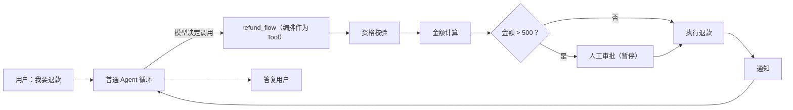

# 写图编排与团队

> 普通对话 Agent 不写图（prebuilt + 治理包装）；**必须按固定步骤走**的流程写图——退款必须先校验资格、再算金额、再审批、再执行，交给 Skill 或 Prompt 是"祈祷模型遵守"，交给图编排是"代码保证执行"。

## 图编排（GraphBuilder）

**是什么**：基于 LangGraph 的流水线编排：步骤节点（确定性代码或 Agent 节点）、检查点持久化、暂停/恢复、人工审批节点。节点内仍复用定义层的一切（大脑、Tool、治理、Trace）。

**与 LangChain 怎么结合**：节点就是普通 Python 函数，函数里直接用本系统的模型与 Tool——同一套 LangChain 对象，没有适配层。三种形态：节点 = Tool（确定性步骤）；节点 = Agent（该步骤需要模型判断）；**流程 = Tool**——整条流水线挂成 Agent 的一个工具，什么时候进流程由模型决定，进了流程每一步由代码保证：



### GraphBuilder 全 API

| 方法 | 作用 |
| --- | --- |
| `.entry(name)` | 入口节点（必设） |
| `.step(name, fn)` | 步骤节点，`fn` 收 dict state 返回 dict |
| `.human(name, prompt=...)` | 人工节点——运行到此处 **interrupt 暂停**，等待人工决策后继续 |
| `.edge(a, b)` | 普通边，显式连接两个节点 |
| `.when(name, cond, then=..., otherwise=...)` | 条件边，按 state 谓词路由分支 |
| `.build()` | 校验拓扑，返回编译图 |

### 完整示例（退款流水线）

```python
from lubanagent.graph import GraphBuilder

def _check_eligibility(state): ...   # 资格校验，返回 {"order": order, "checked": True}
def _compute_amount(state): ...      # 金额计算，返回 {"amount": amt, "needs_approval": amt > 500}
def _execute_refund(state): ...      # 执行退款
def _notify(state): ...              # 通知

refund_flow = (
    GraphBuilder("refund_flow", description="退款流水线")
    .entry("check_eligibility")                          # 入口节点（必设）
    .step("check_eligibility", _check_eligibility)       # step(name, fn)，fn 收 dict state 返回 dict
    .step("compute_amount", _compute_amount)
    .human("approve", prompt="金额 >500 元，需人工审批")  # 人工节点（独立方法，interrupt 暂停）
    .step("execute_refund", _execute_refund)
    .step("notify", _notify)
    .edge("check_eligibility", "compute_amount")        # 普通边显式连接
    .when("compute_amount",                              # 条件边（独立方法）
          lambda s: s.get("needs_approval"),
          then="approve", otherwise="execute_refund")
    .edge("approve", "execute_refund")
    .edge("execute_refund", "notify")
    .build()                                            # 校验拓扑，返回编译图
)

# 经 @graph 注册；import 本模块即注册（app.graphs 是约定扫描入口）
from lubanagent.extension import graph

@graph(name="refund_flow", description="退款流水线")
def refund_flow_builder():
    return refund_flow
```

放在 `app/graphs/` 下的文件会被 `EXTENSION_PACKAGES` 自动扫描——import 本模块即注册。Agent 定义把退款入口指向 `refund_flow` 即可；每次流转写 Trace，大额在人工节点暂停等待确认。

**边界**：编排是给"确定性流程"用的，不是给"所有流程"用的——普通对话型 Agent 不需要编排，全部要素留在定义层；没有强制顺序要求的场景不要画流水线，白付代码成本。工作台「流程图」页提供只读拓扑视图，**编辑图走代码**（改流程 = 改代码发版，保持流程的可测试与可审计）。

## 多 Agent 团队（Teambuilder）

**是什么**：图编排之上再一层——把"节点 = Agent"组合成 supervisor / 子 Agent 委派拓扑：supervisor 决定下一步交给哪个子 Agent、子 Agent 跑完回报、共享状态在节点间流转、可条件路由与人工暂停。

**关键：编排 Run 与单 Agent Run 享同一套治理**——每个子 Agent 调用都进 Trace（绑定各自定义版本与实际模型）、整条编排受预算熔断、高风险节点可人工确认、编排可被评测回归与录制重放。不另起一套治理。

### Teambuilder API

| 方法 | 作用 |
| --- | --- |
| `.supervisor(key)` | 指定 supervisor——必须是**已注册的 Agent key**（带自己的大脑） |
| `.agent(key, description=...)` | 登记成员子 Agent，description 供 supervisor 路由决策 |
| `.route(max_delegations=N)` | 只设委派上限；**路由由 supervisor Agent 的 LLM 决定** |
| `.build()` | 构建团队拓扑 |

### 完整示例（客服分流团队）

```python
from lubanagent.multiagent import TeamBuilder

team = (
    TeamBuilder("cs-team", description="客服分流团队")
    .supervisor("cs-triage")              # supervisor 是已注册的 Agent key（带自己的大脑）
    .agent("cs-faq", description="退货政策咨询")
    .agent("cs-refund", description="退款执行")
    .route(max_delegations=4)             # 只设委派上限；路由由 supervisor Agent 的 LLM 决定
    .build()
)
```

内置示例 `app/multiagents/cs_team.py` 就是这个团队，并经 `app/api/teams.py` 暴露 `POST /v1/teams/cs-team/runs` 触发入口——照着改就能搭自己的团队。

### 预算继承与取消传播

编排不是"另起一套 Run"：**子 Run 是会话 Run 的子 Run**——每个子 Agent 的 Run 继承父 Run 的 Token 预算（整条编排撞线即熔断），父 Run 被取消时取消会传播到所有子 Run。治理口径与单 Agent 完全一致。

**边界**：多 Agent 协作是可选能力——能单 Agent 解决的不要硬凑多 Agent（白付协调成本与 token）。代码优先，不做可视化编排平台。
