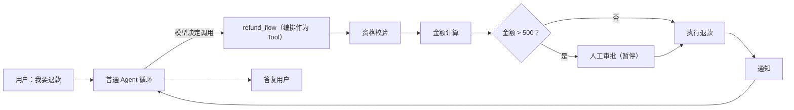

# 图编排

> 本页讲什么时候需要图编排、它与 LangChain 怎么结合、退款流水线示例怎么写，以及"确定性流程才用编排"的边界。

**什么时候需要**：业务流程有强制步骤顺序——退款必须先校验资格、再算金额、再审批、再执行、最后通知，一步不能跳、顺序不能乱。这种事交给 Skill 或 Prompt 是"祈祷模型遵守"，效果不稳定；交给图编排是"代码保证执行"。

**是什么**：基于 LangGraph 的流水线编排：步骤节点（确定性代码或 Agent 节点）、检查点持久化、暂停/恢复、人工审批节点。节点内仍复用定义层的一切（大脑、Tool、治理、Trace）。

**与 LangChain 怎么结合**：节点就是普通 Python 函数，函数里直接用本系统的模型与 Tool——同一套 LangChain 对象，没有适配层。三种形态：节点 = Tool（确定性步骤）；节点 = Agent（该步骤需要模型判断）；**流程 = Tool**——整条流水线挂成 Agent 的一个工具，什么时候进流程由模型决定，进了流程每一步由代码保证：



**怎么用**（示意）：

```python
from lubanagent.graph import GraphBuilder

def _check_eligibility(state): ...   # 资格校验，返回 {"order": order, "checked": True}
def _compute_amount(state): ...      # 金额计算，返回 {"amount": amt, "needs_approval": amt > 500}
def _execute_refund(state): ...      # 执行退款
def _notify(state): ...              # 通知

refund_flow = (
    GraphBuilder("refund_flow", description="退款流水线")
    .entry("check_eligibility")                          # 入口节点（必设）
    .step("check_eligibility", _check_eligibility)       # step(name, fn)，fn 收 dict state 返回 dict
    .step("compute_amount", _compute_amount)
    .human("approve", prompt="金额 >500 元，需人工审批")  # 人工节点（独立方法，interrupt 暂停）
    .step("execute_refund", _execute_refund)
    .step("notify", _notify)
    .edge("check_eligibility", "compute_amount")        # 普通边显式连接
    .when("compute_amount",                              # 条件边（独立方法）
          lambda s: s.get("needs_approval"),
          then="approve", otherwise="execute_refund")
    .edge("approve", "execute_refund")
    .edge("execute_refund", "notify")
    .build()                                            # 校验拓扑，返回编译图
)

# 经 @graph 注册；import 本模块即注册（app.graphs 是约定扫描入口）
from lubanagent.extension import graph

@graph(name="refund_flow", description="退款流水线")
def refund_flow_builder():
    return refund_flow
```

Agent 定义把退款入口指向 `refund_flow` 即可；每次流转写 Trace，大额在人工节点暂停等待确认。流程图页面的只读拓扑视图见[开发者工作台](./workbench.md)。

**边界**：编排是给"确定性流程"用的，不是给"所有流程"用的——普通对话型 Agent 不需要编排，全部要素留在定义层；没有强制顺序要求的场景不要画流水线，白付代码成本。
