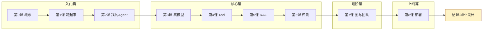

# 开篇词：8 课，从一个名词都不懂，到把 Agent 部署上生产

> 这是一套**动手教程**，不是参考手册。你从第 1 课开始敲命令，到第 8 课结束时，手里会有一个自己命名、自己配模型、带自己写的工具和知识库、有评测基线、能部署的完整 Agent 项目。
>
> 每一课的每一条命令都在写作时真实跑过；每一步后面跟着"你应该看到……"的检查点——对不上就停下来查，别硬往下走。

## 为什么要开这门课

Agent 这个词被讲烂了，但大多数教程停在两处：要么演示一遍 API 调用就散场，要么一上来就是 LangGraph 源码。中间缺的那一段——**怎么把一个模型变成一个能干活的、可控的、敢上生产的系统**——正是这门课要带你们走完的路。

教这门课的载体是 [LubanAgent](https://github.com/lozsh/LuBan)：一个开源的 Agent 工程基座。选它当教材不是因为它功能全，而是因为它把 Agent 工程化要踩的每一类坑都正面回答了：定义怎么管、模型怎么换、出了问题怎么查、钱怎么控、改完怎么敢上线。你学会的不是一个框架的用法，是一套可以直接搬走的工程方法。

适用版本：0.1.x（行为以 master 为准，版本声明见文末）。

## 学习路径：四篇八课

第 0 课不用装任何东西，读完全套概念即可。从第 1 课起是线性路径：每一课都建立在前一课的产出上。

## 课程表

| 课 | 标题 | 学完你能 | 耗时 | 难度 |
|---|---|---|---|---|
| 入门篇 ||||
| [0](00-primer.md) | 认识 Agent | 说清 LLM、Tool、RAG、记忆、评测、图编排这些发明各自解决什么问题，看懂一次 Agent 运行时发生了什么 | 15 分钟（只读） | ★☆☆ |
| [1](01-setup-and-first-run.md) | 跑起来 | 在本机跑起完整开发栈，完成第一次对话并看懂事件流（零密钥），逛遍工作台 | 30-45 分钟 | ★☆☆ |
| [2](02-first-agent.md) | 第一个自己的 Agent | 写出你的 Agent 定义并验证定义落库与版本化 | 30 分钟 | ★☆☆ |
| 核心篇 ||||
| [3](03-real-models.md) | 接真实模型 | 把 DeepSeek/Qwen 接进槽位，让你的人设真正开口说话，换模型不改代码 | 30 分钟 | ★★☆ |
| [4](04-write-a-tool.md) | 写自己的 Tool | 写低风险和高风险工具，走通人工审批流 | 45-60 分钟 | ★★☆ |
| [5](05-knowledge-rag.md) | 给 Agent 加知识 | 建知识库、调切块、配置防错答守门 | 45 分钟 | ★★☆ |
| [6](06-evals.md) | 用评测保质量 | 写评测数据集、跑回归对比，改动不再靠感觉 | 45 分钟 | ★★☆ |
| 进阶篇 ||||
| [7](07-graphs-and-teams.md) | 确定性流程与多 Agent | 写图编排（含人工审批节点）、搭 supervisor 团队 | 60-90 分钟 | ★★★ |
| 上线篇 ||||
| [8](08-deploy.md) | 部署上生产 | Docker 全栈部署、Langfuse 观测、演练跟上游升级 | 60 分钟 | ★★★ |
| 结课 ||||
| [9](09-graduation.md) | 毕业设计与验收 | 用自己的验收单证明成果，完成一个毕业设计方向 | 2-6 小时 | ★★★ |

## 贯穿主线：图书馆借阅助手

从第 2 课开始，你会逐步搭起一个**图书馆借阅助手** `my-lib-assistant`：查借阅记录（低风险工具）、校园卡挂失（高风险+审批）、馆藏规章问答（RAG 防错答）、借阅规则评测集、逾期处理流程（图编排）、咨询台团队（多 Agent）。

选图书馆不是随机的——它跟仓库内置的客服示例结构完全同构，你随时可以翻 `app/agents/`、`app/tools/` 里的"标准答案"对照。而它又不是客服，你得自己想人设、自己定风险等级、自己设计评测用例，这些东西抄不来。

当然，你完全可以换成自己的场景——奶茶店点单助手、社团招新答疑、实验室设备管理，所有步骤同构。教程末尾的 `reference/` 目录只维护图书馆版的参考产出，保证教程本身可验证。

## 怎么学（三条纪律）

1. **别跳课**。这套课是递进设计的，第 6 课的评测集是第 7 课流程的回归保障，跳过去后面全是坑。
2. **检查点对不上就停**。每课的"你应该看到"是真实跑出来的输出，对不上先查该课"常见坑"，再提 Issue——报的人多了我们会修教程或修代码。
3. **思考题先自己答**。每课开头有钩子问题，结尾给答案。直接翻答案的收益，只有自己想过一遍的三成。

## 环境要求（第 1 课起）

- Python ≥ 3.11（推荐 3.12）
- [uv](https://docs.astral.sh/uv/)（Python 包管理器）
- Node.js ≥ 20（工作台前端；只跑 API 可不需要）
- 第 3 课起：一个大模型 API Key（DeepSeek / 通义 / 智谱 / OpenAI 任一，充值约 10 元足够走完全部教程）——第 1-2 课零密钥可完成，但工具调用、RAG、评测的完整体验从第 3 课开始
- 可选：Docker（第 8 课）

## 学完之后你拥有什么

不是一个"跟练demo"，是一个可以写进简历、可以拿出来演示的项目：

1. **一个你自己的 Agent 产品**：`my-lib-assistant`（或你的场景），带人设、真实模型、两个以上你写的工具（含审批流）、RAG 知识库、评测集与回归基线、一条图编排流程、一个多 Agent 团队——全部住在 `app/` 你的领地里；
2. **一份可量化的证据**：评测通过报告 + Trace 回放（能看到每次对话的 token 消耗和费用）；
3. **一个可运行的部署**：Docker 五服务全栈；
4. **一次真实的升级演练**：证明"克隆这个基座改造后，能跟着上游升级而不丢自己的东西"——这是 LubanAgent 作为"起步基座"的核心承诺，你亲手验证过它。

第 9 课有六个毕业设计方向可选，每个都附验收标准。

## 这套教程和其他文档的关系

| 文档 | 回答什么问题 | 什么时候看 |
|---|---|---|
| **本教程** | 第一次怎么做、为什么这么做 | 从头到尾顺着做一遍 |
| [使用手册](../manual/index.md) | 某个功能的全部字段、所有选项 | 做完教程后，用到再查 |
| [客服示例 README](https://github.com/lozsh/LuBan/blob/master/demos/customer_service/README.md) | 最快看到 LubanAgent 长什么样 | 赶时间、不想系统学 |

教程里只出现当课用到的字段和命令子集，全量定义都在手册里——每课末尾的"延伸阅读"标了对应的手册章节。

## 版本适配

- 本教程基于 0.1.x 编写，涉及的行为（`luban init` 幂等语义、SSE 事件名、`my-` 命名空间等）登记在仓库 `docs/specs/modules/tutorial.md`，随仓库演进维护。
- 如果哪一步的检查点对不上，先看该课"常见坑"一节，再提 Issue 告诉我们——报的人多了我们会修教程或修代码。
